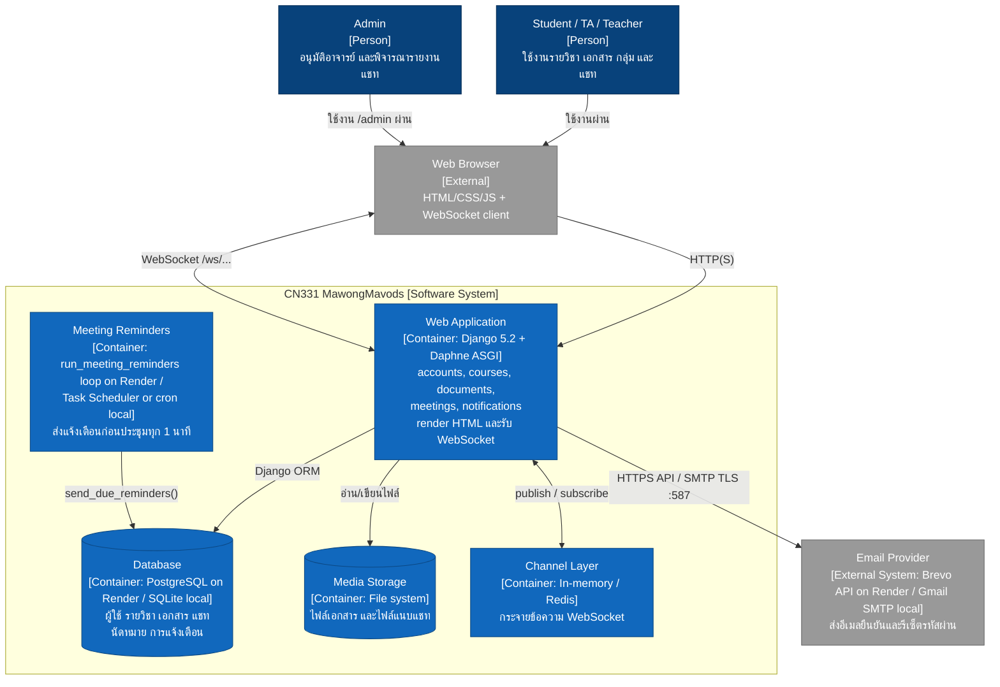
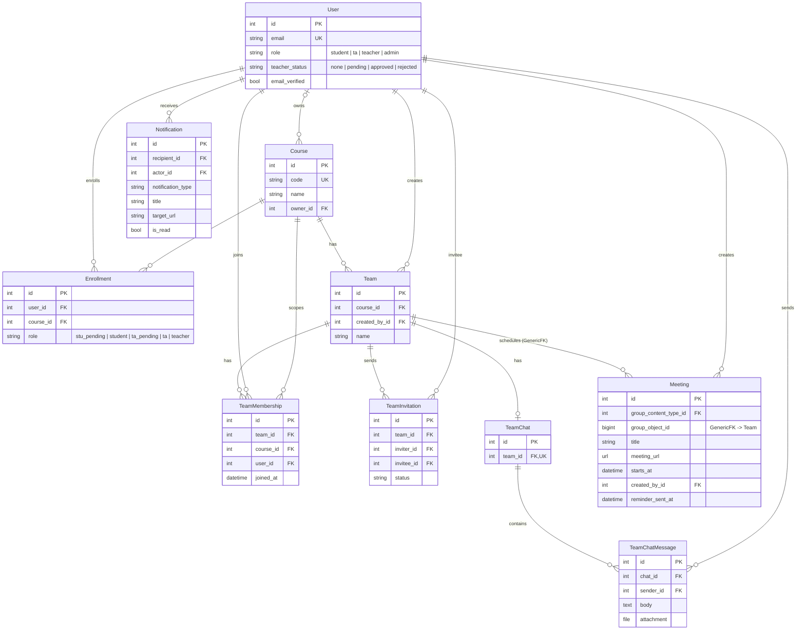
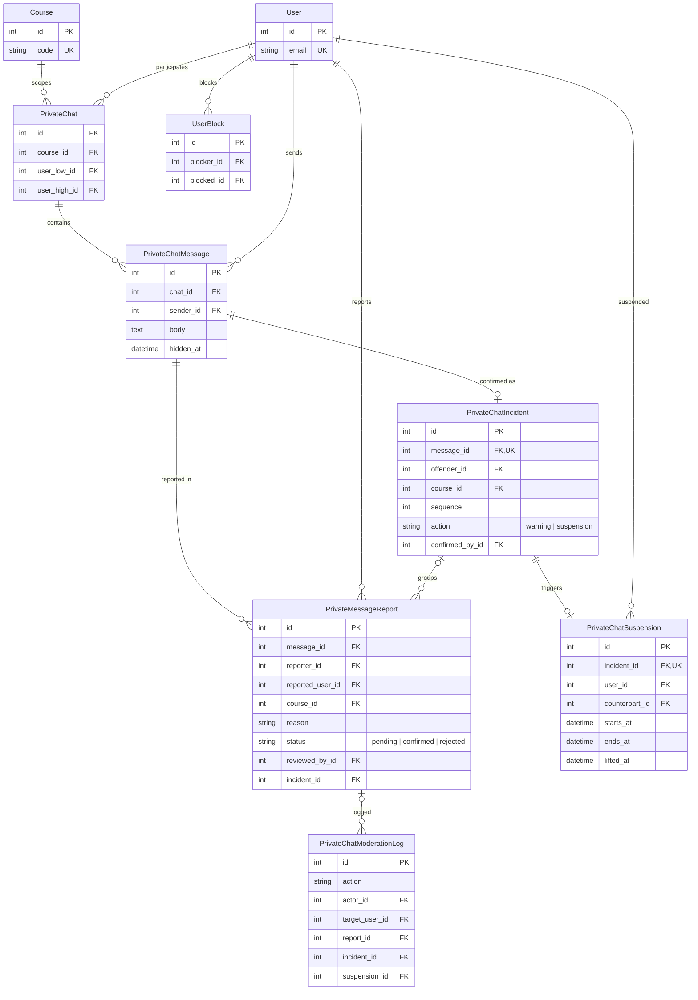
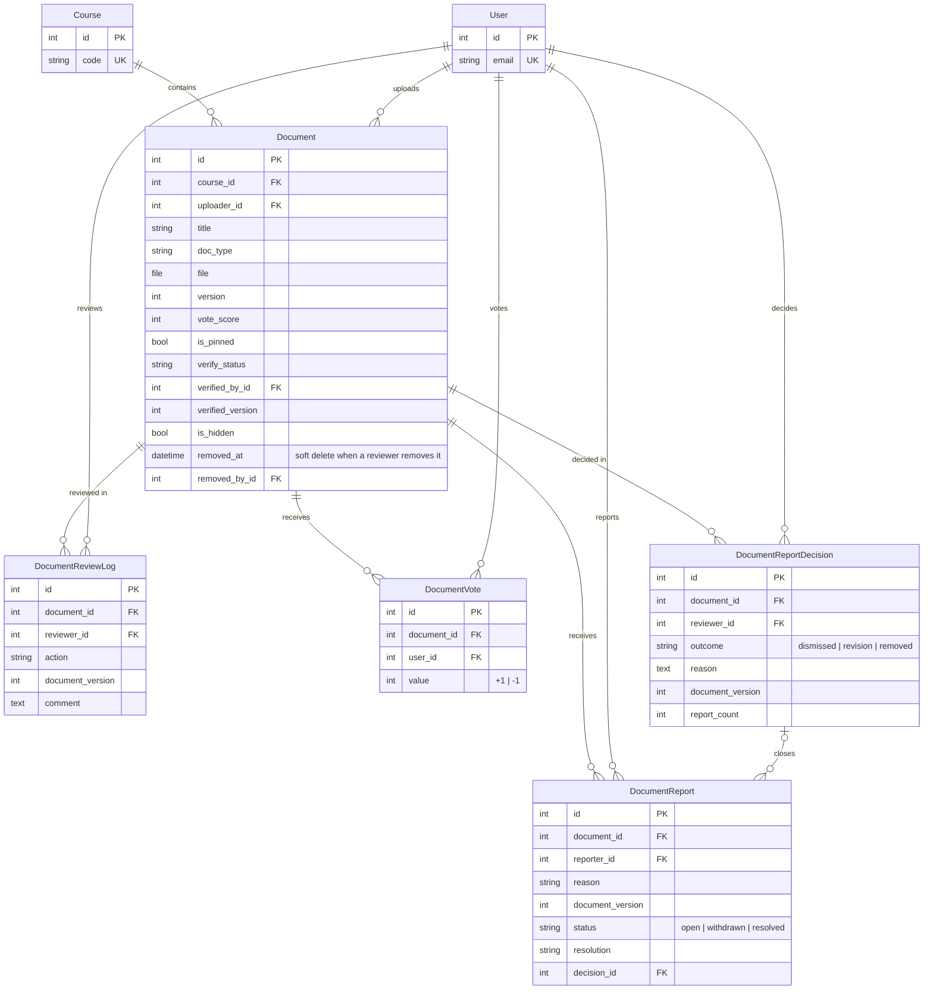

# CN331 MawongMavods

[](https://github.com/6710685055/CN331_MawongMavods/actions/workflows/ci.yml)

**Live Production:** https://&lt;your-app&gt;.onrender.com <!-- TODO: ใส่ URL จริงหลัง deploy บน Render -->

เว็บแอปชุมชนการเรียนสำหรับรายวิชา พัฒนาด้วย Django 5.2 (โครงงานวิชา CN331 Software Engineering)

## สารบัญ

1. [System Overview](#1-system-overview)
2. [Live Demo](#2-live-demo)
3. [Architecture](#3-architecture)
4. [Local Setup](#4-local-setup)
5. [Testing & Coverage](#5-testing--coverage)
6. [Features — รายละเอียดแต่ละฟีเจอร์](#6-features--รายละเอียดแต่ละฟีเจอร์)
7. [Git Workflow สำหรับการทำงานร่วมกัน](#7-git-workflow-สำหรับการทำงานร่วมกัน)
8. [ข้อควรระวัง](#8-ข้อควรระวัง)
9. [เอกสารอ้างอิงภายในโปรเจกต์](#9-เอกสารอ้างอิงภายในโปรเจกต์)

---

## 1. System Overview

### 1.1 วัตถุประสงค์

MawongMavods เป็นพื้นที่กลางของนักศึกษา TA และอาจารย์ในแต่ละรายวิชา โดยมีเป้าหมายดังนี้

- ให้ผู้ใช้สมัครสมาชิก ยืนยันตัวตนด้วยอีเมล และลงทะเบียนเข้ารายวิชาตามบทบาท (นักศึกษา / TA / อาจารย์)
- เป็นคลังเอกสารประจำรายวิชาที่น่าเชื่อถือ มี TA/อาจารย์ตรวจและให้ป้าย Verified มีการโหวตคุณภาพ และ Report เอกสารที่ไม่เหมาะสม
- ช่วยการทำงานกลุ่ม ตั้งแต่จัดกลุ่ม แชทกลุ่มและแชทส่วนตัวแบบเรียลไทม์ ไปจนถึงนัดประชุม พร้อมแจ้งเตือนภายในระบบ

### 1.2 สมาชิกทีม

| ชื่อ-นามสกุล | รหัสนักศึกษา 
|---|---|
| Phatcharaphon Malaisri | 6710685055 
| Sitthipong Kamngam | 6710615284 
| Mingkhwan Saikrajang | 6710615219 
| Panithan Tuntue | 6710615144 
| Napattira Loaklemhung | 6710545010

### 1.3 ฟีเจอร์หลัก

**บัญชีผู้ใช้**
- **สมัครสมาชิกและเข้าสู่ระบบ (Registration & Login):** สมัครสมาชิก ยืนยันอีเมล เข้าสู่ระบบ รีเซ็ตรหัสผ่าน และลงทะเบียนรายวิชา

**กลุ่มโปรเจกต์**
- **จัดตั้งกลุ่ม (Group Formation):** ค้นหาเพื่อนที่ยังไม่มีกลุ่ม ส่งและตอบรับคำเชิญ และแชทกลุ่ม
- **แชทกลุ่ม (Group Chat):** สนทนาระหว่างสมาชิกในกลุ่ม
- **ออกจากกลุ่ม (Leave Group):** สมาชิกออกจากกลุ่ม โอนหัวหน้ากลุ่ม และแจ้งเตือนสมาชิกที่เหลือ
- **นัดประชุมกลุ่มและแจ้งเตือน (Group Meeting & Notification):** สร้างและจัดการนัดประชุมกลุ่ม พร้อมแจ้งเตือนสมาชิก

**แชทส่วนตัว**
- **แชทส่วนตัว (Private Chat):** แชทส่วนตัวกับนักศึกษา/TA ในรายวิชาเดียวกัน พร้อมแจ้งเตือน บล็อก รายงานข้อความ และพิจารณารายงาน คำเตือน หรือระงับ 24 ชั่วโมงผ่าน Django Admin

**เอกสารรายวิชา**
- **จัดการเอกสาร (Document Management):** อัปโหลด แชร์ ปักหมุด และจัดการเอกสารในรายวิชา
- **ตรวจสอบเอกสาร (Document Verification):** ตรวจสอบ ยืนยัน และส่งเอกสารกลับเพื่อแก้ไข พร้อมระบบแจ้งเตือน
- **โหวตและรายงานเอกสาร (Vote & Report Document):** โหวตคุณภาพเอกสาร (Upvote/Downvote) และ Report เอกสารที่ไม่เหมาะสม พร้อมซ่อนอัตโนมัติเมื่อถึงเกณฑ์
- **พิจารณาเอกสารที่ถูกรายงาน (Review Reported Documents):** TA/อาจารย์ตรวจเอกสารที่ถูก Report แล้วปฏิเสธ Report ส่งกลับให้แก้ไข หรือลบเอกสาร พร้อมแจ้งเตือนเจ้าของและผู้ Report
- **แก้ไขและลบเอกสาร (Edit & Delete Documents):** เจ้าของเอกสารแก้ไขข้อมูลเอกสาร และลบเอกสารพร้อมไฟล์ได้

---

## 2. Live Demo

| Environment | URL |
|---|---|
| Production (Render) | https://&lt;your-app&gt;.onrender.com <!-- TODO --> |
| Django Admin | https://&lt;your-app&gt;.onrender.com/admin/ <!-- TODO --> |

### 2.1 Deploy บน Render (Free plan)

โปรเจกต์มี [render.yaml](render.yaml) (Blueprint) ซึ่งสร้าง web service และ PostgreSQL ให้ในครั้งเดียว

1. **เตรียมการส่งอีเมล:** Render Free บล็อก SMTP port 25/465/587 จึงใช้ Gmail SMTP ไม่ได้ ให้สมัคร [Brevo](https://www.brevo.com/) (แพ็กเกจฟรี) แล้ว
   - ยืนยันอีเมลผู้ส่งที่เมนู Senders
   - สร้าง API key ที่เมนู SMTP & API → API Keys
2. push โค้ดขึ้น GitHub
3. ที่ Render Dashboard เลือก **New → Blueprint** แล้วเลือก repo นี้
4. กรอกตัวแปรที่ Render ถาม (ตัวที่เป็น `sync: false`):

| ตัวแปร | ค่า |
|---|---|
| `BREVO_API_KEY` | API key จาก Brevo |
| `DJANGO_DEFAULT_FROM_EMAIL` | ผู้ส่งที่ยืนยันใน Brevo แล้ว เช่น `Student Community <you@gmail.com>` |
| `DJANGO_SUPERUSER_EMAIL` / `DJANGO_SUPERUSER_PASSWORD` | บัญชีผู้ดูแลระบบ ซึ่ง `build.sh` สร้างให้ เพราะ Free plan ไม่มี shell รหัสผ่านต้องผ่าน password validator ของ Django ถ้าไม่ผ่าน build จะ fail |
| `DJANGO_SUPERUSER_FIRST_NAME` / `DJANGO_SUPERUSER_LAST_NAME` | ชื่อ-นามสกุลของผู้ดูแลระบบ |

5. รอ deploy เสร็จ แล้วนำ URL `https://<ชื่อ service>.onrender.com` มาใส่ในตารางด้านบน

ตัวแปรที่ Blueprint ตั้งให้อัตโนมัติ:

| ตัวแปร | ค่า |
|---|---|
| `DATABASE_URL` | connection string ของ `cn331-db` (PostgreSQL) |
| `DJANGO_SECRET_KEY` | สุ่มให้ตอนสร้าง |
| `DJANGO_DEBUG` | `0` |
| `ENABLE_MEETING_REMINDER_LOOP` | `1` (รัน reminder loop คู่กับเว็บ) |
| `PYTHON_VERSION` | `3.12.8` |
| `RENDER`, `RENDER_EXTERNAL_HOSTNAME` | Render ตั้งให้เอง settings ใช้ค่านี้เปิด HTTPS, secure cookie, `ALLOWED_HOSTS` และ `CSRF_TRUSTED_ORIGINS` |

ขั้นตอนบน Render:
- `build.sh`: ติดตั้ง dependencies → `collectstatic` → `migrate` → `seed_courses` → `ensure_superuser`
  - `ensure_superuser` ข้ามไปถ้าไม่ได้ตั้ง `DJANGO_SUPERUSER_EMAIL` หรือมีบัญชีนี้อยู่แล้ว
  - ทำให้ build fail ถ้าตัวแปร `DJANGO_SUPERUSER_*` ไม่ครบ หรือรหัสผ่านอ่อนเกินไป
- `start.sh`: เริ่ม `run_meeting_reminders` เป็น background process แล้วรัน `daphne` ที่ `$PORT` ถ้า loop ตาย จะเริ่มใหม่เองหลัง 10 วินาที (ดูได้ในแท็บ **Logs**)

### 2.2 ข้อจำกัดของ Render Free plan

- **ไฟล์อัปโหลดไม่ถาวร:** เอกสารและไฟล์แนบแชทเก็บใน `media/` บนดิสก์ของ instance ซึ่งจะหายทุกครั้งที่ deploy หรือ restart (Free plan ใส่ Persistent Disk ไม่ได้) ข้อมูลในฐานข้อมูลยังอยู่ แต่ลิงก์ดาวน์โหลดไฟล์เก่าจะใช้ไม่ได้
- **Instance หลับ** หลังไม่มีคนใช้ 15 นาที คำขอแรกหลังจากนั้นจะช้าประมาณ 1 นาที และระหว่างหลับ reminder loop ไม่ทำงาน นัดที่เริ่มไปแล้วระหว่างนั้นจะไม่ได้รับแจ้งเตือนย้อนหลัง
- **Reminder loop รันใน instance เดียวกับเว็บ:** ถ้า process ของ loop ตาย `start.sh` จะเริ่มใหม่เองหลัง 10 วินาที แต่ถ้าทั้ง instance ล่ม loop จะกลับมาพร้อมเว็บเท่านั้น ตรวจได้จากข้อความ `Meeting reminder loop started` ในแท็บ **Logs**
- **PostgreSQL ฟรีหมดอายุใน 30 วัน** หลังสร้าง (ต่ออายุได้อีก 14 วันโดยอัปเกรด) พื้นที่ 1 GB และไม่มี backup ถ้าใกล้วันส่งงานให้สร้างใหม่หรืออัปเกรด
- **Channel layer เป็น in-memory** ใช้ได้เพราะมี instance เดียว ถ้าเพิ่ม instance ต้องตั้ง `CHANNEL_REDIS_URL` (เช่น Render Key Value)

---

## 3. Architecture

### 3.1 เทคโนโลยีหลัก

| ส่วน | เทคโนโลยี |
|---|---|
| ภาษา | Python 3.10+ (CI ใช้ 3.12) |
| Framework | Django 5.2 |
| Real-time | Django Channels + Daphne (ASGI / WebSocket) |
| Channel layer | In-memory ตอนพัฒนา และ Redis (`channels-redis`) เมื่อรันหลาย process |
| Database | SQLite ในเครื่อง / PostgreSQL บน Render (`dj-database-url`, `psycopg`) |
| Email | Gmail SMTP ในเครื่อง / Brevo HTTPS API บน Render (`django-anymail`) |
| Static files | WhiteNoise |
| Hosting | Render (Blueprint `render.yaml`) |
| Environment Variables | python-dotenv |
| Frontend | HTML, CSS, JavaScript และ Django Templates |
| CI / Quality | GitHub Actions, coverage, black, flake8, bandit |

### 3.2 C4 Container Diagram



### 3.3 ERD (Entity Relationship Diagram)

ERD แบ่งเป็น 3 ส่วนตามโดเมน `User` และ `Course` เป็นตัวเดียวกันในทุกส่วน แต่ละ entity แสดงเฉพาะ key และฟิลด์สำคัญ ดูฟิลด์ทั้งหมดได้ที่ `*/models.py` และ `documents/models/`

#### 3.3.1 ผู้ใช้ รายวิชา กลุ่ม นัดหมาย และการแจ้งเตือน



#### 3.3.2 แชทส่วนตัวและการพิจารณารายงาน



#### 3.3.3 เอกสาร: จัดการ ตรวจสอบ โหวต/รายงาน พิจารณารายงาน และแก้ไข/ลบ



ข้อจำกัดสำคัญระดับฐานข้อมูล:

- `Enrollment`: ผู้ใช้ลงทะเบียนรายวิชาเดียวกันได้ครั้งเดียว (`unique_user_course`)
- `DocumentVote`: โหวตได้คนละ 1 ครั้งต่อเอกสาร (`unique_vote_per_user`)
- `DocumentReport`: มี Report ที่ยังเปิดอยู่ได้คนละ 1 รายการต่อเอกสาร (`unique_open_report_per_user`)
- `PrivateChat`: เก็บคู่ผู้ใช้เรียงตาม id (`user_low < user_high`) เป็น unique ต่อรายวิชา

### 3.4 โครงสร้างโปรเจกต์

```text
CN331/
├── accounts/            # สมัครสมาชิก เข้าสู่ระบบ และยืนยันอีเมล
├── courses/             # รายวิชา การลงทะเบียน กลุ่มงาน แชทกลุ่ม และแชทส่วนตัว
├── documents/           # อัปโหลด ตรวจสอบ โหวต/Report และพิจารณาเอกสาร
├── meetings/            # นัดหมายประชุมและการแจ้งเตือน
├── notifications/       # ระบบแจ้งเตือนในแอป
├── config/              # Django settings, URL, ASGI configuration
├── templates/           # HTML templates
├── docs/                # เอกสารเทคนิคของแต่ละฟีเจอร์
├── .github/workflows/   # GitHub Actions CI
├── media/               # ไฟล์ที่ผู้ใช้อัปโหลด
├── manage.py
├── requirements.txt     # dependencies สำหรับรันระบบ
├── requirements-dev.txt # + coverage, black, flake8, bandit
├── .coveragerc          # การตั้งค่า coverage (fail_under = 80)
├── pyproject.toml       # การตั้งค่า black และ bandit
├── .flake8
├── render.yaml          # Render Blueprint (web service + PostgreSQL)
├── build.sh             # Render build: install, collectstatic, migrate, seed
├── start.sh             # Render start: reminder loop + Daphne
├── .env.example
└── .gitignore
```

---

## 4. Local Setup

คำสั่งที่ต่างกันตามระบบปฏิบัติการแยกเป็น **Windows (PowerShell)** และ **macOS (Terminal / zsh)** ส่วนคำสั่งที่ไม่ได้แยกใช้ได้เหมือนกันทั้งสองระบบ หลัง activate virtual environment แล้ว ทั้งสองระบบใช้คำสั่ง `python` ได้เหมือนกัน

### 4.1 สิ่งที่ต้องติดตั้งก่อน

- Python 3.10 ขึ้นไป (CI ใช้ 3.12)
- Git

### 4.2 Clone Repository

```bash
git clone https://github.com/6710685055/CN331_MawongMavods.git
cd CN331_MawongMavods
```

### 4.3 สร้างและเปิดใช้ Virtual Environment

**Windows (PowerShell)**

```powershell
py -m venv .venv
.venv\Scripts\Activate.ps1
```

> ถ้า PowerShell แจ้งว่า running scripts is disabled ให้รัน `Set-ExecutionPolicy -Scope CurrentUser RemoteSigned` หนึ่งครั้งแล้ว activate ใหม่ ถ้าใช้ Command Prompt (cmd) ให้รัน `.venv\Scripts\activate.bat` แทน และถ้าเครื่องไม่มีคำสั่ง `py` ให้ใช้ `python -m venv .venv`

**macOS (Terminal / zsh)**

```bash
python3 -m venv .venv
source .venv/bin/activate
```

ถ้า activate สำเร็จ ต้นบรรทัดของ terminal จะขึ้น `(.venv)` ถ้าต้องการออกจาก environment ให้รัน `deactivate`

### 4.4 ติดตั้ง Dependencies

```bash
python -m pip install --upgrade pip
python -m pip install -r requirements-dev.txt
```

`requirements-dev.txt` รวม `requirements.txt` ไว้แล้ว และมีเครื่องมือสำหรับทดสอบและตรวจคุณภาพโค้ด (coverage, black, flake8, bandit) ถ้าต้องการแค่รันระบบ ใช้ `python -m pip install -r requirements.txt` ก็พอ

### 4.5 ตั้งค่า Environment Variables

คัดลอกไฟล์ตัวอย่างเป็น `.env` ไว้ในโฟลเดอร์เดียวกับ `manage.py`

**Windows (PowerShell)**

```powershell
Copy-Item .env.example .env
notepad .env
```

**macOS (Terminal / zsh)**

```bash
cp .env.example .env
open -e .env
```

แก้ค่าในไฟล์ `.env`:

```dotenv
DJANGO_SECRET_KEY=replace-with-a-long-random-secret
DJANGO_DEBUG=1
DJANGO_ALLOWED_HOSTS=localhost,127.0.0.1

EMAIL_HOST_USER=your-gmail-address@gmail.com
EMAIL_HOST_PASSWORD=your-gmail-app-password

# ไม่บังคับ: ใช้เมื่อรันหลาย process/instance (ดูข้อ 4.9)
# CHANNEL_REDIS_URL=redis://localhost:6379/0
```

สร้าง Secret Key แบบสุ่มได้ด้วยคำสั่งนี้ (เหมือนกันทั้งสองระบบ):

```bash
python -c "from django.core.management.utils import get_random_secret_key; print(get_random_secret_key())"
```

| ตัวแปร | รายละเอียด |
|---|---|
| `DJANGO_SECRET_KEY` | Secret key ของ Django |
| `DJANGO_DEBUG` | `1` = เปิด debug, ค่าอื่น = ปิด |
| `DJANGO_ALLOWED_HOSTS` | host ที่อนุญาต คั่นด้วย `,` |
| `EMAIL_HOST_USER` | อีเมล Gmail ที่ใช้ส่งอีเมล |
| `EMAIL_HOST_PASSWORD` | Gmail App Password (ไม่ใช่รหัสผ่านบัญชี Google) |
| `CHANNEL_REDIS_URL` | (ไม่บังคับ) Redis URL สำหรับ channel layer |
| `DATABASE_URL` | (production) PostgreSQL URL ถ้าไม่ตั้งจะใช้ `db.sqlite3` |
| `BREVO_API_KEY` | (production) ถ้าตั้ง ระบบจะส่งอีเมลผ่าน Brevo API แทน Gmail SMTP |
| `DJANGO_DEFAULT_FROM_EMAIL` | (ไม่บังคับ) ที่อยู่ผู้ส่ง ถ้าไม่ตั้งจะใช้ `EMAIL_HOST_USER` |

ค่าอีเมลอื่นกำหนดไว้ใน `config/settings.py`: `EMAIL_HOST=smtp.gmail.com`, `EMAIL_PORT=587`, `EMAIL_USE_TLS=True`

> **หมายเหตุ:** `runserver` ส่งอีเมลจริงผ่าน Gmail SMTP ถ้าไม่ได้ตั้งค่าอีเมล ระบบจะส่งอีเมลยืนยันบัญชีและอีเมลรีเซ็ตรหัสผ่านไม่ได้ ส่วนตอนรันเทส Django ใช้ locmem backend จึงไม่ส่งอีเมลจริง

**ข้อควรระวังเรื่องข้อมูลลับ**

- ห้าม commit ไฟล์ `.env` ขึ้น Git และห้ามเผยแพร่ `DJANGO_SECRET_KEY` หรือรหัสผ่านอีเมล
- `.env.example` มีไว้แสดงชื่อตัวแปรเท่านั้น ห้ามใส่ข้อมูลลับจริง
- ถ้า App Password หรือ Secret Key เคยหลุดออกไป ให้เปลี่ยนค่าใหม่ทันที

### 4.6 ตั้งค่า Database

Migration ทั้งหมด commit อยู่ใน repo แล้ว จึงรันแค่ `migrate` ได้เลย ไม่ต้องรัน `makemigrations`

```bash
python manage.py migrate
python manage.py seed_courses        # เพิ่มรายวิชาตัวอย่าง (รันซ้ำได้)
python manage.py createsuperuser     # สร้างบัญชีผู้ดูแลระบบ (role = admin, ยืนยันอีเมลให้อัตโนมัติ)
```

### 4.7 เริ่ม Development Server

```bash
python manage.py runserver
```

`runserver` ทำงานแบบ ASGI ผ่าน Daphne เพราะ Daphne อยู่ใน `INSTALLED_APPS` จึงรองรับ WebSocket ของแชทได้ทันที

| หน้า | URL |
|---|---|
| หน้าหลัก (redirect ไปวิชาของฉัน) | http://127.0.0.1:8000/ |
| สมัครสมาชิก | http://127.0.0.1:8000/accounts/register/ |
| เข้าสู่ระบบ | http://127.0.0.1:8000/accounts/login/ |
| รายวิชาทั้งหมด | http://127.0.0.1:8000/courses/ |
| นัดหมายของฉัน | http://127.0.0.1:8000/meetings/ |
| การแจ้งเตือน | http://127.0.0.1:8000/notifications/ |
| Django Admin | http://127.0.0.1:8000/admin/ |

### 4.8 ตั้งเวลาส่งแจ้งเตือนการประชุม

คำสั่ง `send_meeting_reminders` ส่งแจ้งเตือนให้การประชุมที่จะเริ่มภายใน 15 นาที (`MEETING_REMINDER_MINUTES`) Django ไม่ได้รันคำสั่งนี้ให้อัตโนมัติ ต้องตั้งให้ระบบปฏิบัติการเรียกทุก 1 นาที

ทดสอบรันด้วยมือ:

```bash
python manage.py send_meeting_reminders
```

ถ้าไม่อยากตั้ง scheduler ให้เปิดอีก terminal แล้วรันคำสั่งแบบวนลูปแทน (บน Render ใช้วิธีนี้ผ่าน `start.sh`):

```bash
python manage.py run_meeting_reminders              # รันทุก 60 วินาทีจนกว่าจะกด Ctrl+C
python manage.py run_meeting_reminders --interval 30
python manage.py run_meeting_reminders --once       # รันรอบเดียว
```

**Windows: Task Scheduler** (เปลี่ยน `C:\path\to\CN331_MawongMavods` เป็น path จริง)

```powershell
schtasks /Create /SC MINUTE /MO 1 /TN "CN331 Meeting Reminders" `
  /TR "C:\path\to\CN331_MawongMavods\.venv\Scripts\python.exe C:\path\to\CN331_MawongMavods\manage.py send_meeting_reminders"

# ลบ task เมื่อไม่ใช้แล้ว
schtasks /Delete /TN "CN331 Meeting Reminders" /F
```

**macOS: cron** รัน `crontab -e` แล้วเพิ่มบรรทัดนี้ (เปลี่ยน path เป็น path จริง)

```cron
* * * * * cd /path/to/CN331_MawongMavods && .venv/bin/python manage.py send_meeting_reminders >> /tmp/cn331-reminders.log 2>&1
```

### 4.9 Redis สำหรับแชทหลาย process (ไม่บังคับ)

ตอนพัฒนาบนเครื่อง ระบบใช้ in-memory channel layer ได้ทันที ต้องใช้ Redis เมื่อรันหลาย worker/instance เท่านั้น

**Windows:** ใช้ Docker Desktop (หรือ Redis ใน WSL)

```powershell
docker run -d --name cn331-redis -p 6379:6379 redis:7
```

**macOS:** ใช้ Homebrew

```bash
brew install redis
brew services start redis
```

จากนั้นเพิ่ม `CHANNEL_REDIS_URL=redis://localhost:6379/0` ในไฟล์ `.env` แล้วเริ่มเซิร์ฟเวอร์ใหม่

---

## 5. Testing & Coverage

ทุกคำสั่งในหัวข้อนี้ต้องรันหลัง activate virtual environment และติดตั้ง `requirements-dev.txt` แล้ว

### 5.1 ตรวจสอบ Configuration และ Migration

```bash
python manage.py check
python manage.py makemigrations --check --dry-run
```

คำสั่งที่สองจะ fail ถ้ามีการแก้ model แต่ยังไม่ได้สร้าง migration

### 5.2 รันเทสพร้อมวัด Coverage

```bash
coverage run manage.py test
coverage report -m
coverage html
```

`.coveragerc` ตั้งค่าไว้แล้ว: วัด branch coverage ของแอป `accounts`, `courses`, `documents`, `meetings`, `notifications` ไม่นับ migrations, tests, `admin.py`, `apps.py` และกำหนด `fail_under = 80` ถ้า coverage รวมต่ำกว่า 80% คำสั่ง `coverage report` จะ fail

เปิดรายงาน HTML:

**Windows (PowerShell)**

```powershell
start htmlcov\index.html
```

**macOS (Terminal / zsh)**

```bash
open htmlcov/index.html
```

### 5.3 สรุปผล Coverage

วัดเมื่อ 2026-11-08 จาก branch `chore/render-deploy`: **223 tests ผ่านทั้งหมด**

| แอป | Coverage |
|---|---|
| `accounts` | 98% |
| `courses` | 81% |
| `documents` | 83% |
| `meetings` | 97% |
| `notifications` | 79% |
| **รวม (TOTAL)** | **85%** (เกณฑ์ขั้นต่ำ 80%) |

ผลล่าสุดของแต่ละ commit ดูได้จาก GitHub Actions: หน้า job summary ของ workflow **CI** มีตาราง coverage และดาวน์โหลดรายงาน HTML/XML ได้จาก artifact `coverage-report`

### 5.4 รันเทสเฉพาะแอปหรือเฉพาะฟีเจอร์

```bash
python manage.py test                 # ทั้งหมด
python manage.py test accounts        # เฉพาะแอป
```

| ฟีเจอร์ | คำสั่ง |
|---|---|
| สมัครสมาชิก เข้าสู่ระบบ และลงทะเบียนรายวิชา (Registration & Enrollment) | `python manage.py test accounts courses.tests` |
| จัดตั้งกลุ่ม แชทกลุ่ม และออกจากกลุ่ม (Group & Group Chat) | `python manage.py test courses.test_uc_group` |
| นัดประชุมกลุ่มและแจ้งเตือน (Group Meeting) | `python manage.py test meetings` |
| นักศึกษาที่ยังไม่มีกลุ่ม (Unassigned Students) | `python manage.py test courses.test_us05_unassigned_students` |
| แชทส่วนตัว (Private Chat) | `python manage.py test courses.test_uc_private_chat courses.test_uc_private_chat_moderation` |
| จัดการเอกสาร (Document Management) | `python manage.py test documents.tests.test_uc3_upload` |
| ตรวจสอบเอกสาร (Document Verification) | `python manage.py test documents.tests.test_uc4_verify` |
| โหวตและรายงานเอกสาร (Vote & Report Document) | `python manage.py test documents.tests.test_uc10_feedback` |
| พิจารณาเอกสารที่ถูกรายงาน (Review Reported Documents) | `python manage.py test documents.tests.test_uc14_reports` |
| แก้ไขและลบเอกสาร (Edit & Delete Documents) | `python manage.py test documents.tests.test_us12_document_management` |

รันเทสเดียวได้ด้วยการระบุ class/method เช่น `python manage.py test accounts.tests.RegisterTests.test_teacher_starts_pending`

### 5.5 ตรวจคุณภาพโค้ด (เหมือนใน CI)

```bash
black --check .
flake8 accounts config courses documents meetings notifications manage.py
bandit -r accounts config courses documents meetings notifications -ll -x "*/tests/*,*/test_*.py,*/migrations/*"
```

ถ้าต้องการให้ black จัดรูปแบบโค้ดให้อัตโนมัติ ใช้ `black .`

### 5.6 CI Pipeline

`.github/workflows/ci.yml` ทำงานทุกครั้งที่ push เข้า `main` และทุก Pull Request (Ubuntu, Python 3.12) มี 2 job

**Job `quality` (SQLite)**

1. ติดตั้ง `requirements-dev.txt`
2. `python manage.py check`
3. `makemigrations --check --dry-run`
4. `coverage run manage.py test` และ `coverage report --fail-under=80`
5. เขียนตาราง coverage ลง job summary และอัปโหลด `coverage.xml` กับ `htmlcov/` เป็น artifact
6. `black --check`, `flake8` และ `bandit`

**Job `postgres-tests`** เปิด PostgreSQL 16 เป็น service container แล้วรัน `migrate` และชุดทดสอบทั้งหมดผ่าน `DATABASE_URL` เพื่อยืนยันว่าโค้ดทำงานบนฐานข้อมูลเดียวกับ production บน Render

### 5.7 ตรวจสอบการเปลี่ยนแปลงก่อน Commit

```bash
git status
git diff --check
git diff --name-only --diff-filter=U
```

คำสั่งสุดท้ายแสดงไฟล์ที่ยังอยู่ในสถานะ Unmerged ถ้าไม่มีรายการแสดงขึ้นมา แปลว่าไม่มีไฟล์ที่ยัง Unmerged

---

## 6. Features — รายละเอียดแต่ละฟีเจอร์

### 6.1 สมัครสมาชิก เข้าสู่ระบบ และลงทะเบียนรายวิชา (Registration, Login & Course Enrollment)

#### 6.1.1 ความสามารถหลัก

- สมัครสมาชิกด้วยข้อมูลที่จำเป็น
- ตรวจสอบความถูกต้องของข้อมูลสมัครสมาชิก
- ตรวจสอบข้อมูลที่ซ้ำกันตามข้อกำหนดของระบบ
- ส่งอีเมลยืนยันบัญชี
- ยืนยันอีเมลผ่านลิงก์
- เข้าสู่ระบบและออกจากระบบ
- ขอรีเซ็ตรหัสผ่านผ่านอีเมล
- ตั้งรหัสผ่านใหม่
- ป้องกันการเข้าถึงหน้าที่ต้องเข้าสู่ระบบโดยไม่ได้รับอนุญาต
- ลงทะเบียนรายวิชาและเข้าถึงรายวิชาที่เกี่ยวข้อง
- ควบคุมการเข้าถึงฟังก์ชันต่าง ๆ ตามสิทธิ์ของผู้ใช้

#### 6.1.2 เส้นทางที่เกี่ยวข้อง

| เส้นทาง | รายละเอียด |
|---|---|
| `/accounts/register/` | สมัครสมาชิก |
| `/accounts/login/` | เข้าสู่ระบบ |
| `/accounts/logout/` | ออกจากระบบ |
| `/accounts/verify/<token>/` | ยืนยันอีเมล |
| `/accounts/password-reset/` | ขอรีเซ็ตรหัสผ่าน |
| `/accounts/password-reset/<uidb64>/<token>/` | ตั้งรหัสผ่านใหม่ |

> เส้นทางจริงอาจแตกต่างกันตาม URL configuration ของโปรเจกต์ ให้ตรวจสอบ `accounts/urls.py` ก่อนใช้งาน

#### 6.1.3 ขั้นตอนการสมัครสมาชิก

1. ผู้ใช้เปิดหน้าสมัครสมาชิก
2. กรอกข้อมูลตามที่ระบบกำหนด
3. ระบบตรวจสอบความถูกต้องของข้อมูล
4. ระบบสร้างบัญชีผู้ใช้ตามเงื่อนไขที่กำหนด
5. ระบบส่งอีเมลยืนยันบัญชี หากเปิดใช้งานการยืนยันอีเมล
6. ผู้ใช้เปิดลิงก์ยืนยันอีเมล
7. ผู้ใช้สามารถเข้าสู่ระบบได้ตามเงื่อนไขของระบบ

#### 6.1.4 ขั้นตอนการเข้าสู่ระบบ

1. ผู้ใช้เปิดหน้าเข้าสู่ระบบ
2. กรอกข้อมูลประจำตัว
3. ระบบตรวจสอบข้อมูล
4. หากข้อมูลถูกต้อง ระบบจะอนุญาตให้เข้าสู่ระบบ
5. ระบบนำผู้ใช้ไปยังหน้าที่กำหนด
6. หากข้อมูลไม่ถูกต้อง ระบบจะแสดงข้อความแจ้งเตือน

#### 6.1.5 ขั้นตอนการรีเซ็ตรหัสผ่าน

1. ผู้ใช้เลือกเมนูลืมรหัสผ่าน
2. กรอกอีเมลที่ใช้กับบัญชี
3. ระบบส่งลิงก์สำหรับตั้งรหัสผ่านใหม่ หากเป็นไปตามเงื่อนไข
4. ผู้ใช้เปิดลิงก์จากอีเมล
5. กำหนดรหัสผ่านใหม่
6. เข้าสู่ระบบด้วยรหัสผ่านใหม่

---

### 6.2 จัดตั้งกลุ่ม แชทกลุ่ม และออกจากกลุ่ม (Group Formation, Group Chat & Leave Group)

#### 6.2.1 ความสามารถและกติกา

- นักศึกษาที่ได้รับอนุมัติให้ลงทะเบียนในรายวิชา เปิดเมนู “ระบบจัดกลุ่ม” เพื่อดูเพื่อนที่มีกลุ่มและยังไม่มีกลุ่ม
- ผู้สร้างกลุ่มเป็นสมาชิกคนแรก และกลุ่มมีสมาชิกได้ไม่เกิน 5 คนรวมผู้สร้าง
- คำเชิญที่รอตอบรับจะจองที่นั่งไว้ เพื่อไม่ให้เชิญเกินจำนวนสมาชิกที่รับได้
- เมื่อเพื่อนตอบรับ ระบบเพิ่มเป็นสมาชิกและสร้างห้องแชทกลุ่มอัตโนมัติ
- เมื่อเพื่อนปฏิเสธ ระบบแจ้งผู้เชิญ และเพื่อนยังคงไม่มีกลุ่ม
- นักศึกษาหนึ่งคนอยู่ได้ไม่เกินหนึ่งกลุ่มต่อหนึ่งรายวิชา
- สมาชิกที่อยู่ในห้องแชทเห็นข้อความใหม่ทันทีผ่าน WebSocket และสมาชิกอื่นได้รับการแจ้งเตือนในระบบ
- รองรับข้อความและ URL รวมถึงไฟล์ PDF, DOCX, PPTX, PNG และ JPG ขนาดไม่เกิน 10 MB
- การเปิดแชท การดาวน์โหลดไฟล์ และการรับข้อความผ่าน WebSocket ตรวจสอบสมาชิกกลุ่มเสมอ

#### 6.2.2 เส้นทางที่เกี่ยวข้อง

| URL | ความสามารถ |
|---|---|
| `/courses/<course_id>/groups/` | ดูสถานะกลุ่มและคำเชิญในรายวิชา |
| `/courses/<course_id>/groups/<team_id>/chat/` | อ่านและส่งข้อความ/ไฟล์ในห้องแชทของกลุ่ม |
| `/ws/courses/<course_id>/groups/<team_id>/chat/` | WebSocket สำหรับส่งและรับข้อความแบบเรียลไทม์ |

หน้าแชทใช้ ASGI ผ่าน Daphne (`python manage.py runserver` ใช้ ASGI เมื่อมี Daphne ใน `INSTALLED_APPS`) ตอนพัฒนาใช้ in-memory channel layer ถ้ารันหลาย worker หรือหลาย instance ให้ตั้ง `CHANNEL_REDIS_URL` เป็น Redis URL เพื่อกระจายข้อความระหว่าง process (ดูข้อ 4.9)

ทางเข้าจากหน้าเว็บ: ไปที่ **วิชาของฉัน** แล้วกด **เปิดระบบจัดกลุ่ม** ในแถวของวิชาที่อาจารย์อนุมัติการลงทะเบียนแล้ว ถ้ายังรออนุมัติ ระบบจะแสดงสถานะรอและยังไม่ให้เข้าหน้าจัดกลุ่ม

#### 6.2.3 แชทกลุ่ม (Group Chat)

แชทกลุ่มใช้ WebSocket ส่งข้อความทันที และส่ง in-app notification ให้สมาชิกคนอื่นในกลุ่ม ทุกข้อความผ่านการตรวจสมาชิก รวมถึงกรณีที่สมาชิกถูกนำออกจากกลุ่มระหว่างเปิดหน้าอยู่ ไฟล์แนบดาวน์โหลดได้เฉพาะสมาชิกที่ยังอยู่ในกลุ่ม และรับเฉพาะ PDF/DOCX/PPTX/PNG/JPG ขนาดสูงสุด 10 MB

#### 6.2.4 ออกจากกลุ่ม (Leave Group)

- สมาชิกกลุ่มกด **ออกจากกลุ่ม** ในหน้าระบบจัดกลุ่ม และยืนยันก่อนออก
- ระบบเปลี่ยนสถานะสมาชิกเป็น “ยังไม่มีกลุ่ม” และแจ้งเตือนสมาชิกที่เหลือ
- หากหัวหน้ากลุ่มออก ระบบโอนหัวหน้าให้สมาชิกที่อยู่ในกลุ่มนานที่สุด และแสดง badge “หัวหน้ากลุ่ม” ให้สมาชิกคนนั้น
- หากสมาชิกคนสุดท้ายออก ระบบยุบกลุ่มและลบห้องแชท/ข้อความ พร้อมลบไฟล์แนบของห้องนั้น
- เมื่อออกจากกลุ่ม ระบบเพิกถอนสิทธิ์ห้องแชททันที รวมถึง WebSocket ที่เชื่อมต่ออยู่

#### 6.2.5 ทดสอบการจัดตั้งกลุ่ม แชทกลุ่ม และการออกจากกลุ่ม

```bash
python manage.py test courses.test_uc_group
```

#### 6.2.6 งานต่อยอดแชทกลุ่ม

สถานะปัจจุบันและรายการที่ควรทำต่อ:

- [x] สมาชิกที่อยู่ในห้องเดียวกันรับข้อความใหม่ผ่าน WebSocket แบบเรียลไทม์
- [x] บันทึกข้อความและแจ้งเตือนสมาชิกคนอื่นเป็น in-app notification
- [x] รองรับข้อความ URL และไฟล์แนบตามชนิด/ขนาดที่กำหนด พร้อมจำกัดการดาวน์โหลดให้เฉพาะสมาชิก
- [ ] สร้าง `TeamChat` พร้อมกับการสร้าง `Team` ตั้งแต่แรก แทนการสร้างเมื่อมีสมาชิกคนที่สองตอบรับคำเชิญ
- [ ] ทำให้การแจ้งเตือนข้อความใหม่ส่งถึงสมาชิกที่ไม่ได้เปิดหน้าเว็บแบบทันที (เช่น WebSocket notification channel หรือ browser push notification); ปัจจุบันเป็น in-app notification ที่เห็นเมื่อเข้าหน้าแจ้งเตือน/โหลดหน้าใหม่
- [ ] เพิ่มทางเข้าแชทเป็นแท็บหรือส่วนชัดเจนในหน้ากลุ่ม แทนปุ่ม “เปิดห้องแชทกลุ่ม”
- [x] เมื่อสมาชิกออกจากกลุ่มเอง ให้เพิกถอนสิทธิ์หน้าแชท การดาวน์โหลดไฟล์ และ WebSocket ที่เชื่อมต่ออยู่ พร้อม regression tests
- [ ] เมื่อผู้ดูแลรายวิชานำสมาชิกออก ให้เพิกถอนสิทธิ์แชท/ไฟล์แนบและ WebSocket ที่เชื่อมต่ออยู่ พร้อมเพิ่ม regression tests สำหรับ flow นั้น
- [ ] ทดสอบการตั้งค่า Redis และการ broadcast เมื่อรันหลาย worker/instance; in-memory channel layer เหมาะกับการพัฒนาแบบ process เดียวเท่านั้น

---

### 6.3 นัดประชุมกลุ่มและแจ้งเตือน (Group Meeting & Notification)

สมาชิกกลุ่มทำงาน (Team) สร้างนัดหมาย ระบุหัวข้อ ลิงก์ วันและเวลา ดูนัดหมายที่กำลังจะมาถึงในพื้นที่กลุ่ม และแก้ไขหรือเลื่อนนัดหมายได้ ระบบส่งการแจ้งเตือนภายในแอปให้สมาชิกเมื่อสร้างและเปลี่ยนนัดหมาย (เริ่มใน branch `issue-2-group-meeting-notification` และเปลี่ยนมาใช้ Team ใน Issue #10)

**User Story:** ในฐานะสมาชิกกลุ่ม ฉันต้องการสร้างและจัดการนัดหมายประชุมของกลุ่ม เพื่อให้สมาชิกทุกคนทราบวัน เวลา และลิงก์ประชุม

#### 6.3.1 กลุ่มของนัดหมาย

นัดหมายผูกกับกลุ่มทำงาน (`courses.Team`) ผ่าน adapter `meetings.group_access.TeamAccess` ซึ่งเป็นค่าเริ่มต้นใน `config/settings.py` สมาชิกคือผู้ใช้ active ใน `TeamMembership` ที่ยังลงทะเบียนเป็น Student ในวิชาของกลุ่ม ทุกคนในกลุ่มสร้าง แก้ไข และเลื่อนนัดได้ ผู้ที่ไม่ใช่สมาชิกได้ 403 แม้เข้า URL ตรง ผู้ที่ออกจากกลุ่มหรือถูกถอนจากรายวิชาจะไม่เห็นนัดและไม่ได้รับแจ้งเตือนของกลุ่มนั้นอีก เข้าหน้านัดหมายได้จากปุ่ม **นัดหมายประชุม** ในหน้ากลุ่มของรายวิชา ซึ่งแสดงนัดที่กำลังจะมาถึงด้วย

นัดเก่าที่ผูกกับ Django `Group` (ข้อมูลทดสอบก่อนเปลี่ยนมาใช้ Team) ไม่ถูกย้ายหรือลบ แต่ไม่แสดงในกลุ่มใดและคำสั่งเตือนจะข้ามไป ลิงก์ในแจ้งเตือนเก่าที่เป็น `/meetings/groups/<id>/` ใช้ไม่ได้แล้ว

**การแจ้งเตือน:**

- สร้างนัด: แจ้งสมาชิกทุกคนยกเว้นผู้สร้าง
- เลื่อนเวลา: แจ้งทุกคนยกเว้นผู้เลื่อน และเริ่มนับการเตือนใหม่
- แก้เฉพาะชื่อหรือลิงก์: แจ้งทุกคนยกเว้นผู้แก้ โดยไม่รีเซ็ตการเตือน
- เวลาในข้อความเป็นเวลาประเทศไทย

#### 6.3.2 หน้าของระบบนัดประชุม

| หน้า | URL |
|---|---|
| รวมนัดหมายของผู้ใช้ | `/meetings/` |
| พื้นที่นัดหมายของกลุ่ม | `/meetings/teams/<team_id>/` |
| สร้างนัดหมาย | `/meetings/teams/<team_id>/create/` |
| แก้ไขหรือเลื่อนนัดหมาย | `/meetings/<meeting_id>/edit/` |

#### 6.3.3 เกณฑ์การยอมรับ (Acceptance Criteria) และตำแหน่งที่พัฒนา

| เกณฑ์การยอมรับ | ตำแหน่งในโค้ด |
|---|---|
| สมาชิกกลุ่มสร้างนัดหมายได้ โดยตรวจสอบสิทธิ์ | `meetings/views.py`, `meetings/permissions.py`, `meetings/group_access.py` |
| กำหนดหัวข้อ ลิงก์ วันและเวลาได้ พร้อมตรวจ URL และเวลาที่ต้องเป็นอนาคต | `meetings/forms.py`, `meetings/models.py` |
| แสดงนัดหมายที่กำลังจะมาถึง และปักนัดหมายถัดไปไว้ด้านบน | `meetings/selectors.py`, `templates/meetings/group_meetings.html`, `templates/courses/group_dashboard.html` |
| สมาชิกแก้ไขหรือเลื่อนนัดหมายได้ | `meetings/views.py`, `meetings/services.py`, `templates/meetings/meeting_form.html` |
| แจ้งสมาชิกเมื่อสร้างหรือเปลี่ยนนัดหมาย | `meetings/services.py`, `notifications/services.py`, `notifications/models.py` |

#### 6.3.4 ข้อจำกัดและคำสั่งเฉพาะ

- แจ้งเตือนเป็นแบบภายในแอป ผู้ใช้เห็นเมื่อเปิดหรือรีเฟรชหน้าเว็บ ระบบแจ้งเตือนแบบ real-time แยกเป็น issue ของระบบ Notification ส่วนกลาง
- การตั้งเวลารัน `send_meeting_reminders` บน Windows และ macOS ดูข้อ 4.8

```bash
python manage.py test meetings
```

ดูรายละเอียดการออกแบบเพิ่มเติมได้ที่ `docs/meeting_uc2.md`

---

### 6.4 จัดการเอกสาร (Document Management)

#### 6.4.1 ความสามารถหลัก

- อัปโหลดเอกสารเข้าสู่รายวิชา
- จัดเก็บไฟล์ที่ผู้ใช้อัปโหลด
- แชร์เอกสารให้ผู้ใช้ที่เกี่ยวข้อง
- ปักหมุดเอกสารเพื่อให้ค้นหาได้ง่าย
- แสดงรายการเอกสารในรายวิชา
- ตรวจสอบสิทธิ์การเข้าถึงเอกสาร
- จำกัดชนิดไฟล์ที่สามารถอัปโหลดได้
- จำกัดขนาดไฟล์ตามที่ระบบกำหนด

#### 6.4.2 ชนิดไฟล์ที่รองรับ

ชนิดไฟล์ที่อนุญาตตามการตั้งค่าปัจจุบัน ได้แก่

- PDF (`.pdf`)
- Microsoft Word (`.docx`)
- Microsoft PowerPoint (`.pptx`)
- PNG (`.png`)
- JPEG (`.jpg`)

ขนาดไฟล์สูงสุดตามการตั้งค่าปัจจุบันคือ 50 MB

> ชนิดไฟล์และขนาดไฟล์ที่อนุญาตขึ้นอยู่กับการตั้งค่าใน `config/settings.py` (`DOCUMENT_ALLOWED_EXTENSIONS`, `DOCUMENT_MAX_FILE_SIZE_MB`) และการตรวจสอบไฟล์ของแอปพลิเคชัน

#### 6.4.3 ขั้นตอนการอัปโหลดเอกสาร

1. ผู้ใช้เข้าสู่ระบบ
2. เปิดหน้ารายวิชาที่ต้องการ
3. เลือกเมนูอัปโหลดเอกสาร
4. เลือกไฟล์และกรอกข้อมูลที่จำเป็น
5. ระบบตรวจสอบข้อมูลและไฟล์
6. หากผ่านการตรวจสอบ ระบบจะบันทึกข้อมูลเอกสาร
7. ระบบจัดเก็บไฟล์และแสดงเอกสารตามสิทธิ์การเข้าถึง

#### 6.4.4 การแชร์และปักหมุดเอกสาร

- ผู้ใช้สามารถแชร์เอกสารตามสิทธิ์ที่ระบบกำหนด
- ผู้ใช้สามารถปักหมุดเอกสารเพื่อให้เข้าถึงได้สะดวก
- ระบบควรตรวจสอบสิทธิ์ก่อนอนุญาตให้แก้ไขข้อมูลเอกสาร
- ระบบควรป้องกันไม่ให้ผู้ใช้ที่ไม่มีสิทธิ์เข้าถึงเอกสารส่วนตัวหรือเอกสารที่ถูกจำกัดสิทธิ์

#### 6.4.5 Acceptance Criteria

| ID | เงื่อนไขการทดสอบ | ผลลัพธ์ที่คาดหวัง |
|---|---|---|
| UC3-01 | อัปโหลดไฟล์ชนิดที่รองรับ | ระบบรับไฟล์และบันทึกข้อมูลได้ |
| UC3-02 | อัปโหลดไฟล์ชนิดที่ไม่รองรับ | ระบบปฏิเสธไฟล์และแจ้งข้อผิดพลาด |
| UC3-03 | อัปโหลดไฟล์เกินขนาดที่กำหนด | ระบบปฏิเสธไฟล์ |
| UC3-04 | ผู้ใช้ที่มีสิทธิ์เปิดดูเอกสาร | ระบบแสดงข้อมูลเอกสาร |
| UC3-05 | ผู้ใช้ที่ไม่มีสิทธิ์พยายามเข้าถึงเอกสาร | ระบบปฏิเสธการเข้าถึง |
| UC3-06 | ผู้ใช้ปักหมุดเอกสาร | ระบบบันทึกสถานะตามฟังก์ชันที่กำหนด |
| UC3-07 | ผู้ใช้แชร์เอกสาร | ระบบดำเนินการตามสิทธิ์และเงื่อนไขการแชร์ |

---

### 6.5 ตรวจสอบเอกสารและแจ้งเตือน (Document Verification & Notifications)

#### 6.5.1 ความสามารถหลัก

- ตรวจสอบเอกสารที่ส่งเข้ามา
- ยืนยันเอกสารที่ผ่านการตรวจสอบ
- ส่งเอกสารกลับเพื่อให้ผู้ใช้แก้ไข
- ยกเลิกสถานะการยืนยันตามสิทธิ์ที่กำหนด
- แจ้งเตือนผู้ใช้เมื่อสถานะเอกสารเปลี่ยนแปลง
- แสดงสถานะปัจจุบันของเอกสาร

#### 6.5.2 ขั้นตอนการตรวจสอบเอกสาร

1. ผู้ตรวจสอบเปิดรายการเอกสารที่รอตรวจสอบ
2. เลือกเอกสารที่ต้องการตรวจสอบ
3. ตรวจสอบข้อมูลและเนื้อหาของเอกสาร
4. เลือกดำเนินการตามเงื่อนไขของระบบ เช่น ยืนยันหรือส่งกลับเพื่อแก้ไข
5. ระบบบันทึกสถานะใหม่
6. ระบบแจ้งเตือนผู้ใช้ที่เกี่ยวข้อง หากกำหนดให้มีการแจ้งเตือน
7. ผู้ใช้สามารถตรวจสอบสถานะเอกสารได้

#### 6.5.3 สถานะเอกสาร

สถานะที่แสดงขึ้นอยู่กับการออกแบบและการตั้งค่าในแอปพลิเคชัน โดยอาจประกอบด้วย

- รอตรวจสอบ
- ยืนยันแล้ว
- ส่งกลับเพื่อแก้ไข

การเปลี่ยนสถานะต้องเป็นไปตามสิทธิ์และเงื่อนไขที่กำหนดในระบบ

#### 6.5.4 Acceptance Criteria

| ID | เงื่อนไขการทดสอบ | ผลลัพธ์ที่คาดหวัง |
|---|---|---|
| UC4-01 | ผู้ตรวจสอบเปิดเอกสารที่รอตรวจสอบ | ระบบแสดงข้อมูลเอกสาร |
| UC4-02 | ผู้มีสิทธิ์ยืนยันเอกสาร | ระบบอัปเดตสถานะเป็นยืนยันแล้ว |
| UC4-03 | ผู้มีสิทธิ์ส่งเอกสารกลับเพื่อแก้ไข | ระบบอัปเดตสถานะตามที่กำหนด |
| UC4-04 | ผู้ไม่มีสิทธิ์พยายามยืนยันเอกสาร | ระบบปฏิเสธการดำเนินการ |
| UC4-05 | สถานะเอกสารเปลี่ยนแปลง | ระบบบันทึกสถานะใหม่ |
| UC4-06 | มีเหตุการณ์ที่ต้องแจ้งเตือน | ระบบแจ้งเตือนผู้ใช้ที่เกี่ยวข้อง |
| UC4-07 | ผู้ใช้เปิดดูสถานะเอกสาร | ระบบแสดงสถานะล่าสุด |

---

### 6.6 แชทส่วนตัว (Private Chat)

**User Story:** ในฐานะนักศึกษา/TA ฉันต้องการสนทนากับผู้ใช้คนอื่นแบบส่วนตัว เพื่อให้สามารถติดต่อหรือพูดคุยเรื่องที่ไม่ต้องการส่งในกลุ่มได้

- ผู้ใช้ได้แก่นักศึกษาและ TA ที่ได้รับอนุมัติในรายวิชา (`Enrollment.Role.STUDENT` / `TA`) ผู้ที่รออนุมัติและอาจารย์ไม่อยู่ในรายชื่อ
- ทางเข้า: หน้ารายวิชา → **💬 แชทส่วนตัว** → เลือกเพื่อนจากรายชื่อในรายวิชา → กด **ส่งข้อความ**
- ห้องแชท (`PrivateChat`) ผูกกับรายวิชาและคู่ผู้ใช้ โดยเก็บคู่ผู้ใช้เรียงตาม id (`user_low < user_high`) และมี unique constraint ระดับฐานข้อมูล จึงไม่เกิดห้องซ้ำแม้ทั้งสองฝ่ายเปิดพร้อมกัน (กรณีชนกันระบบดึงห้องเดิมกลับมา)
- ข้อความ (`PrivateChatMessage`) ถูกบันทึกเป็นประวัติ ส่งผ่าน WebSocket แบบเรียลไทม์ และยังส่งด้วยฟอร์ม POST ปกติได้เมื่อไม่ได้เชื่อมต่อ WebSocket
- **ประวัติแชท:** หน้าแชทแสดงข้อความล่าสุด 100 ข้อความ (`PRIVATE_CHAT_PAGE_SIZE`) กด **โหลดข้อความเก่า** เพื่อโหลดทีละชุดผ่าน endpoint JSON ที่ใช้ cursor (`created_at`, `id`) ของข้อความเก่าสุดที่แสดงอยู่ จึงเรียงลำดับแน่นอนและไม่ซ้ำ แม้มีข้อความใหม่เข้ามาระหว่างโหลด ตำแหน่งเลื่อนคงอยู่ที่เดิม และแสดง “ไม่มีข้อความเก่ากว่านี้แล้ว” เมื่อโหลดครบ
- ผู้รับได้รับ in-app notification ประเภท `private_chat_message` พร้อมลิงก์เข้าห้อง (ไม่ใส่เนื้อหาข้อความในแจ้งเตือน)
- **Block (`UserBlock`):** เมื่อฝ่ายใดบล็อก ทั้งสองฝ่ายส่งข้อความถึงกันไม่ได้ทุกห้อง/ทุกรายวิชา จนกว่าผู้บล็อกจะกด **ยกเลิกบล็อก** (เฉพาะผู้บล็อกเท่านั้นที่ยกเลิกได้) ประวัติเดิมยังอ่านได้ หลัง block/unblock ทุกครั้ง server ส่ง event `block.state` ผ่าน WebSocket ให้ทั้งสองหน้าที่เปิดอยู่ โดยแต่ละการเชื่อมต่ออ่านสถานะจริงจากฐานข้อมูล (รวมกรณีต่างฝ่ายต่างบล็อก) และส่งอีกครั้งทุกครั้งที่เชื่อมต่อใหม่ ช่องส่งข้อความจึงเปิด/ปิดตามสถานะล่าสุดโดยไม่ต้องรีเฟรช ส่วนการส่งข้อความยังตรวจ block ฝั่ง server เสมอ
- **Report (`PrivateMessageReport`):** ผู้รับรายงานข้อความของอีกฝ่ายได้ โดยเลือกเหตุผลและระบุรายละเอียดเพิ่มเติม ระบบบันทึกผู้รายงาน ผู้ถูกรายงาน รายวิชา สำเนาข้อความ เวลาที่ส่ง และ snapshot ข้อความใกล้เคียงไม่เกิน 3 ข้อความก่อน/หลัง (`REPORT_CONTEXT_SIZE`) รายงานใหม่มีสถานะ `pending` (รอตรวจสอบ) รายงานข้อความเดิมซ้ำไม่ได้ รายงานข้อความของตัวเองไม่ได้ และรายงานข้อความที่ถูกซ่อนแล้วไม่ได้
- **การตรวจสิทธิ์ฝั่ง server:** ทุกการเปิดห้อง อ่านประวัติ ส่งข้อความ (ทั้ง HTTP และ WebSocket) block และ report ตรวจว่าเป็นคู่สนทนาของห้องนั้น และทั้งสองคนยังลงทะเบียนในรายวิชาของห้อง ผู้ไม่มีสิทธิ์ได้ 404 / WebSocket ถูกปิดด้วย code 4403 การเปลี่ยนสถานะทั้งหมดเป็น POST ที่มี CSRF token และแสดงข้อความด้วย template auto-escaping

#### 6.6.1 การพิจารณารายงานและบทลงโทษ

1. **คิวรายงาน:** Django Admin → *Private message reports* แสดงรายงานพร้อมตัวกรองสถานะ (รอตรวจสอบ / ยืนยันรายงาน / ปฏิเสธรายงาน) หน้าแต่ละรายงานแสดงหลักฐานและบริบทข้อความใกล้เคียง ซึ่งเห็นได้เฉพาะใน Admin
2. **สิทธิ์:** อ่านคิวได้เมื่อเป็น staff และมี permission `courses.view_privatemessagereport` หรือ `courses.review_privatemessagereport`; ตัดสินรายงานและยกเลิกการระงับได้เฉพาะ staff ที่มี `courses.review_privatemessagereport` (superuser มีอยู่แล้ว) ตรวจทั้งใน Admin และใน service (`courses/private_chat_moderation.py`)
3. **ตัดสิน:** เลือก “ยืนยันรายงาน” หรือ “ปฏิเสธรายงาน” พร้อมหมายเหตุ ระบบบันทึกผู้ตรวจ เวลา และหมายเหตุ รายงานที่ตัดสินแล้วเป็นแบบอ่านอย่างเดียว การ submit ซ้ำหรือสองคนกดพร้อมกันจะถูกปฏิเสธ (อัปเดตสถานะแบบ compare-and-set จาก `pending`)
4. **ปฏิเสธ:** ข้อความแสดงตามปกติ ไม่นับเป็นเหตุการณ์ และแจ้งผลแก่ผู้รายงาน
5. **ยืนยัน:** ข้อความถูกซ่อนจากหน้าแชทของทั้งสองฝ่าย (ตั้ง `hidden_at`, ไม่ลบแถว) หน้าที่เปิดอยู่จะลบข้อความออกผ่าน WebSocket event `message.hidden` หลักฐานยังอยู่ในรายงาน และใน `PrivateChatIncident` แจ้งผลแก่ผู้รายงาน และแจ้งผู้ส่งตามบทลงโทษ
6. **การนับ:** หนึ่งข้อความเป็นหนึ่งเหตุการณ์ (`PrivateChatIncident`, unique ต่อข้อความ) แม้มีหลายรายงานหรือกดซ้ำ นับเฉพาะที่ยืนยันแล้ว ต่อผู้ส่งหนึ่งคน
   - เหตุการณ์ที่ 1–3: ซ่อนข้อความและออกคำเตือน (แจ้งว่าเป็นครั้งที่เท่าไรจาก 3)
   - เหตุการณ์ที่ 4 เป็นต้นไป: ซ่อนข้อความและสร้าง `PrivateChatSuspension` ระงับผู้ส่งจากการส่งข้อความถึงผู้ที่รายงาน (คู่สนทนาของข้อความนั้น) 24 ชั่วโมงนับจากเวลาที่ยืนยัน
7. **ขอบเขตการระงับ:** มีผลเฉพาะการส่งข้อความส่วนตัวจากผู้ถูกระงับถึงคู่สนทนานั้น (ทุกห้องของคู่นี้) อ่านประวัติได้ตามปกติ อีกฝ่ายยังส่งหาได้ ไม่สร้างหรือแก้ `UserBlock` และไม่กระทบแชทกลุ่ม
8. **การบังคับใช้:** ทุกการส่งข้อความ (HTTP POST และ WebSocket) ตรวจ `starts_at <= now < ends_at` และ `lifted_at` จากฐานข้อมูล ไม่มีตัวจับเวลาใน process เมื่อเลยเวลา `ends_at` ก็ส่งได้ทันที หน้าแชทแสดงแถบแจ้งเวลาสิ้นสุด และ event `block.state` มี `suspended_until`
9. **ยกเลิกการระงับก่อนกำหนด:** Django Admin → *Private chat suspensions* → เปิดรายการที่ยังมีผล กรอกเหตุผล แล้วบันทึก ระบบเก็บผู้ยกเลิก เวลา และเหตุผล แจ้งผู้ถูกระงับ และอัปเดตหน้าแชทที่เปิดอยู่
10. **Audit trail:** `PrivateChatModerationLog` บันทึกการยืนยัน/ปฏิเสธ คำเตือน การระงับ และการยกเลิกระงับ (ผู้ดำเนินการ ผู้ได้รับผล หมายเหตุ เวลา) เปิดดูใน Admin แบบอ่านอย่างเดียว ลบไม่ได้
11. **การแจ้งเตือน:** ใช้ระบบ Notification กลาง (`send_notification`) ประเภท `private_report_result` (ถึงผู้รายงาน), `private_chat_warning`, `private_chat_suspended`, `private_chat_unsuspended` (ถึงผู้ถูกรายงาน) แจ้งเตือนถึงผู้ถูกรายงานไม่ระบุชื่อผู้รายงานหรือผู้ตรวจ และไม่มีลิงก์ไปยังห้อง แจ้งเตือนเป็น in-app ที่เห็นเมื่อโหลดหน้าใหม่ ยังไม่มี toast แบบ real-time (เป็นงานแยกของระบบ Notification ทั้งโปรเจกต์)

ตั้งค่าผู้ตรวจ: สร้าง superuser หรือ staff แล้วให้ permission *“พิจารณารายงานข้อความส่วนตัวและยกเลิกการระงับ”* ใน Django Admin → Users

> คำเตือน การระงับ และ audit trail เก็บในฐานข้อมูลเท่านั้น ดูข้อควรทราบเรื่อง SQLite บน Render ในหัวข้อ 2

#### 6.6.2 เส้นทางที่เกี่ยวข้อง

| URL | ความสามารถ |
|---|---|
| `/courses/<course_id>/chats/` | รายการบทสนทนาและรายชื่อในรายวิชา |
| `/courses/<course_id>/chats/start/<user_id>/` | (POST) เปิดห้องเดิมหรือสร้างห้องใหม่ |
| `/courses/<course_id>/chats/<chat_id>/` | อ่านประวัติ / (POST) ส่งข้อความ |
| `/courses/<course_id>/chats/<chat_id>/messages/?before=<message_id>` | (GET, JSON) โหลดข้อความเก่ากว่าข้อความที่ระบุทีละชุด |
| `/courses/<course_id>/chats/<chat_id>/block/` | (POST) บล็อกคู่สนทนา |
| `/courses/<course_id>/chats/<chat_id>/unblock/` | (POST) ยกเลิกบล็อก |
| `/courses/<course_id>/chats/<chat_id>/messages/<message_id>/report/` | (POST) รายงานข้อความ |
| `/ws/courses/<course_id>/chats/<chat_id>/` | WebSocket ส่งและรับข้อความแบบเรียลไทม์ |

โค้ดหลัก: `courses/models.py`, `courses/private_chat_services.py`, `courses/private_chat_moderation.py`, `courses/admin.py`, `courses/private_chat_views.py`, `courses/consumers.py` (`PrivateChatConsumer`), `templates/courses/private_chat_list.html`, `templates/courses/private_chat.html`

#### 6.6.3 ทดสอบแชทส่วนตัว

```bash
python manage.py test courses.test_uc_private_chat courses.test_uc_private_chat_moderation
```

ทดลองใช้งาน: สร้างผู้ใช้นักศึกษา 2 คนในรายวิชาเดียวกันและให้อาจารย์อนุมัติ (หรือเพิ่มผ่าน Django Admin) เข้าสู่ระบบด้วยคนละเบราว์เซอร์หรือหน้าต่างไม่ระบุตัวตน แล้วเปิด **แชทส่วนตัว** จากหน้ารายวิชา

---

### 6.7 โหวตและรายงานเอกสาร (Vote & Report Document)

รายละเอียดเชิงเทคนิคอยู่ที่ `docs/documents_uc10.md`

#### 6.7.1 ความสามารถหลัก

- สมาชิกรายวิชาโหวตเอกสาร 👍/👎 ได้คนละ 1 โหวตต่อเอกสาร กดซ้ำเพื่อยกเลิก กดอีกฝั่งเพื่อเปลี่ยน และคะแนนสุทธิอัปเดตทันทีโดยไม่โหลดหน้าใหม่
- Report เอกสารโดยเลือกเหตุผล (ผิดวิชา/ผิดหมวดหมู่, เนื้อหาไม่ถูกต้อง, สแปม, ละเมิดลิขสิทธิ์, เนื้อหาไม่เหมาะสม, อื่นๆ) ถ้าเลือก "อื่นๆ" ต้องกรอกรายละเอียด
- ถอน Report ของตนเองได้ก่อน TA/อาจารย์ตัดสิน
- เมื่อผู้ Report (นับไม่ซ้ำคน) ถึงเกณฑ์ `DOCUMENT_REPORT_HIDE_THRESHOLD` (ค่าเริ่มต้น 5 ใน `config/settings.py`) ระบบซ่อนเอกสารและแจ้งเตือนเจ้าของกับ TA/อาจารย์ ระหว่างซ่อน เอกสารเห็นได้เฉพาะเจ้าของ TA และอาจารย์
- คิวตรวจ Report สำหรับ TA/อาจารย์อยู่ในหัวข้อ 6.8 พิจารณาเอกสารที่ถูกรายงาน

#### 6.7.2 Acceptance Criteria

| ID | เงื่อนไข | โค้ดที่รับผิดชอบ | Test |
|---|---|---|---|
| UC10-01 | เฉพาะสมาชิกรายวิชาโหวต/Report ได้ (ตรวจฝั่ง Server) | `services/feedback.py: _require_can_vote_or_report` | `test_outsider_and_owner_cannot_vote_or_report` |
| UC10-02 | เจ้าของโหวต/Report เอกสารตัวเองไม่ได้ และไม่เห็นปุ่ม | `permissions.can_vote_or_report`, `partials/vote_widget.html` | `test_owner_does_not_see_vote_or_report_buttons` |
| UC10-03 | 1 โหวตต่อคน กดซ้ำยกเลิก กดอีกฝั่งเปลี่ยน | `vote_document`, `unique_vote_per_user` | `test_vote_toggle_switch_and_net_score`, `test_duplicate_vote_blocked_by_database` |
| UC10-04 | แสดงคะแนนสุทธิและโหวตของผู้ใช้ อัปเดตโดยไม่ reload | `views/feedback.py` (JSON), `static/documents/js/vote.js` | `test_vote_endpoint_returns_json_and_shows_user_vote` |
| UC10-05 | ต้องเลือกเหตุผล และ "อื่นๆ" ต้องกรอกรายละเอียด | `ReportDocumentForm`, `REASONS_REQUIRING_DETAIL` | `test_report_requires_reason_and_detail_for_other` |
| UC10-06 | Report ซ้ำขณะค้างไม่ได้ (กันซ้ำระดับ DB) | `unique_open_report_per_user` | `test_duplicate_open_report_rejected_and_db_constraint` |
| UC10-07 | ถอน Report ได้ก่อนตัดสิน | `withdraw_report` | `test_withdraw_report`, `test_withdraw_keeps_hidden_until_no_open_reports_remain` |
| UC10-08 | ถึงเกณฑ์ → ซ่อน + แจ้งเตือนเจ้าของและ TA/อาจารย์ (ครั้งเดียว) | `_hide_if_threshold_reached`, `services/notifiers.py` | `test_threshold_hides_document_and_notifies_once` |
| UC10-09 | ระหว่างซ่อน เห็นเฉพาะเจ้าของ TA อาจารย์ และโหวตไม่ได้ | `permissions.can_view_document`, `list_course_documents` | `test_hidden_document_visibility_and_no_voting` |
| UC10-10 | Report ที่ถูกปฏิเสธ Report ซ้ำไม่ได้จนกว่าจะมีเวอร์ชันใหม่ | `selectors.has_dismissed_report` | `test_dismissed_report_blocks_rereport_until_new_version` |
| UC10-11 | เจ้าของไม่เห็นชื่อผู้ Report | `constants/feedback.py` (ข้อความแจ้งเตือน), `partials/hidden_banner.html` | `test_threshold_hides_document_and_notifies_once`, `test_hidden_document_visibility_and_no_voting` |

---

### 6.8 พิจารณาเอกสารที่ถูกรายงาน (Review Reported Documents)

รายละเอียดเชิงเทคนิคอยู่ที่ `docs/documents_uc14.md`

#### 6.8.1 ความสามารถหลัก

- TA ที่ได้รับอนุมัติและอาจารย์ผู้สอนเปิดเมนู "🚩 เอกสารที่ถูก Report" ได้จากหน้ารายวิชาหรือคลังเอกสาร คิวเรียงเอกสารที่ถูกซ่อนก่อน แล้วตามจำนวน Report พร้อมสรุปเหตุผล
- เปิดดูเอกสาร (ดาวน์โหลดได้แม้ถูกซ่อน) และรายละเอียด Report รวมถึงชื่อผู้ Report
- ตัดสินได้ 3 แบบ
  - **ปฏิเสธ Report:** เอกสารแสดงตามปกติ ป้าย Verified คงอยู่
  - **ส่งกลับให้แก้ไข:** ต้องมีเหตุผล สถานะเป็น "ต้องแก้ไข" และป้าย Verified ถูกถอด
  - **ลบเอกสาร:** ต้องมีเหตุผลและยืนยันอีกครั้ง เอกสารหายจากคลังและดาวน์โหลดไม่ได้
- ทุกการตัดสินปิด Report ทั้งหมดของเอกสาร บันทึกผู้ตัดสิน ผล เหตุผล และวันเวลา (`DocumentReportDecision`) แล้วแจ้งเตือนเจ้าของ (ไม่มีชื่อผู้ Report) และผู้ Report ทุกคน

#### 6.8.2 Acceptance Criteria

| ID | เงื่อนไข | โค้ดที่รับผิดชอบ | Test |
|---|---|---|---|
| UC14-01 | เฉพาะ TA ที่อนุมัติแล้วและ Teacher ของวิชาเข้าคิวและปุ่มดำเนินการได้ (ตรวจฝั่ง Server) | `permissions.can_access_report_queue`, `services/moderation.py: _require_can_moderate` | `test_only_approved_staff_can_access_queue_and_actions` |
| UC14-02 | คิวแสดงเหตุผลและจำนวน Report เรียงเอกสารที่ซ่อนก่อน แล้วตามจำนวน | `selectors.reported_documents`, `selectors.reason_summary_for` | `test_queue_order_counts_reasons_and_excludes_own_uploads` |
| UC14-03 | ผู้ตรวจเปิดดูเอกสารและรายละเอียด Report ได้ | `views/moderation.py: report_review_view` | `test_reviewer_sees_reporter_names_but_owner_cannot` |
| UC14-04 | เลือกได้ 3 ทาง และต้องมีเหตุผลเมื่อส่งกลับหรือลบ | `ResolveReportsForm`, `RESOLUTIONS_REQUIRING_REASON` | `test_revision_requires_reason_drops_badge_and_returns_to_pending_after_fix`, `test_remove_requires_reason_and_confirmation_and_hides_everywhere` |
| UC14-05 | การลบต้องยืนยันอีกครั้ง | `RESOLUTIONS_REQUIRING_CONFIRMATION`, `static/documents/js/moderation.js` | `test_remove_via_http_requires_confirm_checkbox` |
| UC14-06 | ปฏิเสธ: แสดงปกติ ป้าย Verified คงอยู่ ตัวนับ Report เป็น 0 | `_apply_dismiss` | `test_dismiss_unhides_keeps_badge_and_resets_count` |
| UC14-07 | ส่งกลับ: สถานะ "ต้องแก้ไข" และถอดป้าย Verified | `_apply_revision`, `services/versioning.py` | `test_revision_requires_reason_drops_badge_and_returns_to_pending_after_fix`, `test_revision_of_homework_resets_after_owner_replaces_file` |
| UC14-08 | ลบ: ไม่แสดงในคลังและดาวน์โหลดไม่ได้ | `_apply_remove`, `ActiveDocumentManager` | `test_remove_requires_reason_and_confirmation_and_hides_everywhere` |
| UC14-09 | ปิด Report ทั้งหมด และบันทึกผู้ตัดสิน ผล เหตุผล วันเวลา | `_close_open_reports`, `DocumentReportDecision` | `test_decision_closes_all_reports_and_records_who_what_why_when` |
| UC14-10 | แจ้งเตือนเจ้าของพร้อมเหตุผล และแจ้งผู้ Report ทุกคน ทุกผลการตัดสิน | `notifiers.notify_report_decision` | `test_owner_and_all_reporters_notified_for_every_outcome` |
| UC14-11 | เจ้าของไม่เห็นชื่อผู้ Report | `constants/moderation.py`, `report_review_view` (403 สำหรับเจ้าของ) | `test_reviewer_sees_reporter_names_but_owner_cannot` |
| UC14-12 | ผู้ตรวจไม่เห็นและตัดสินเอกสารที่ตัวเองอัปโหลดไม่ได้ | `reported_documents(exclude_uploader=...)`, `CANNOT_MODERATE_OWN` | `test_queue_order_counts_reasons_and_excludes_own_uploads` |
| UC14-13 | ผู้ตรวจสองคนพร้อมกัน: บันทึกครั้งเดียว และคนที่สองได้ "ดำเนินการแล้ว" | conditional UPDATE ใน `_close_open_reports` | `test_second_concurrent_decision_is_rejected_and_not_recorded` |
| UC14-14 | เจ้าของลบเอกสารเองระหว่างรอ (ผ่านหน้าแก้ไขและลบเอกสาร): ปิด Report และแจ้งผู้ Report (การลบเป็น hard delete จึงไม่เก็บประวัติการตัดสิน) | `close_reports_for_owner_deletion`, `services/management.py: delete_document` | `test_owner_deletion_hook_closes_reports_and_notifies_reporters`, `test_owner_delete_via_us12_notifies_reporters_and_links_to_library`, `test_owner_delete_without_open_reports_sends_no_report_notifications` |

---

### 6.9 แก้ไขและลบเอกสาร (Edit & Delete Documents)

**User Story:** ในฐานะเจ้าของเอกสาร ฉันต้องการแก้ไขหรือลบเอกสารของตนเอง เพื่อจัดการข้อมูลเอกสารให้ถูกต้องและเป็นปัจจุบัน

#### 6.9.1 ขอบเขตและสิทธิ์

- เจ้าของเอกสารที่ยังเป็นสมาชิกของรายวิชาแก้ไขชื่อ ประเภท ปีการศึกษา ภาคการศึกษา บทที่เกี่ยวข้อง และคำอธิบายได้
- การเปลี่ยนประเภทเอกสารจะตั้งสถานะ Verify ใหม่ตามประเภท หากเปลี่ยนเป็นการบ้าน ต้องยืนยันว่าเลยกำหนดส่งแล้ว
- เจ้าของเปลี่ยนไฟล์แนบเป็นเวอร์ชันใหม่ได้จากหน้าเอกสาร ระบบเพิ่มเลขเวอร์ชันและส่งเอกสารที่ตรวจได้กลับเข้าคิวรอตรวจ
- เฉพาะเจ้าของเอกสารลบได้ การลบส่งด้วย `POST` หลังยืนยัน แล้วลบทั้งไฟล์และข้อมูลโหวต Report และประวัติการตรวจที่ผูกกับเอกสาร
- หน้าเอกสารแสดงปุ่มแก้ไขและลบให้เจ้าของเท่านั้น ส่วนเซิร์ฟเวอร์ตรวจสิทธิ์ซ้ำทุกคำขอ

#### 6.9.2 หน้าของระบบแก้ไขและลบเอกสาร

| การทำงาน | URL | Method |
|---|---|---|
| แก้ไขข้อมูลเอกสาร | `/courses/<course_id>/documents/<doc_id>/edit/` | `GET`, `POST` |
| เปลี่ยนไฟล์เป็นเวอร์ชันใหม่ | `/courses/<course_id>/documents/<doc_id>/replace-file/` | `POST` |
| ลบเอกสาร | `/courses/<course_id>/documents/<doc_id>/delete/` | `POST` |

ทุกการทำงานเริ่มจากหน้าเอกสาร `/courses/<course_id>/documents/<doc_id>/` โดยปุ่มแก้ไขและลบแสดงให้เจ้าของเอกสาร

#### 6.9.3 Acceptance Criteria และตำแหน่งที่พัฒนา

| เกณฑ์การยอมรับ | ตำแหน่งในโค้ด |
|---|---|
| เจ้าของแก้ไขข้อมูลที่อนุญาตได้ พร้อมตรวจข้อมูลบังคับและปีการศึกษา | `documents/forms.py`, `documents/services/management.py`, `documents/views/management.py`, `templates/documents/edit.html` |
| ป้องกันสมาชิกคนอื่นหรือผู้ที่ไม่ได้ลงทะเบียนแก้ไขและลบ | `documents/services/management.py`, `documents/views/management.py` |
| เปลี่ยนไฟล์ เพิ่มเลขเวอร์ชัน และรีเซ็ตสถานะ Verify | `documents/services/versioning.py`, `documents/views/review.py` |
| ยืนยันก่อนลบ ส่งคำขอลบด้วย POST และลบไฟล์หลังบันทึกฐานข้อมูล | `templates/documents/detail.html`, `documents/views/management.py`, `documents/services/management.py` |
| ลบโหวต Report และประวัติการตรวจที่อ้างถึงเอกสาร | Foreign keys ใน `documents/models/feedback.py` และ `documents/models/review.py` ใช้ `on_delete=CASCADE` |

```bash
python manage.py test documents.tests.test_us12_document_management
```

---

## 7. Git Workflow สำหรับการทำงานร่วมกัน

ก่อนเริ่มแก้ไขโค้ด ควรตรวจสอบ branch ปัจจุบันและอัปเดตข้อมูลจาก remote

```bash
git status
git branch
git fetch origin
```

เปลี่ยนไปยัง branch ที่ต้องการทำงาน เช่น

```bash
git switch issue-1-registration-login
```

หากต้องการรวมการเปลี่ยนแปลงจาก branch อื่น ให้ตรวจสอบ branch เป้าหมายก่อนดำเนินการ

```bash
git merge <branch-name>
```

หากเกิด Merge Conflict:

1. ตรวจสอบไฟล์ที่มีปัญหาด้วย `git status`
2. เปิดไฟล์และแก้ไขส่วนที่ขัดแย้งกัน
3. ลบเครื่องหมาย Conflict ทั้งหมด ได้แก่ `<<<<<<<`, `=======` และ `>>>>>>>`
4. ตรวจสอบว่าโค้ดและเนื้อหาที่ต้องการเก็บยังอยู่ครบ
5. ทดสอบระบบ
6. เพิ่มไฟล์ที่แก้ไขแล้วด้วย `git add`
7. Commit เมื่อแก้ Conflict ครบทุกไฟล์แล้วเท่านั้น

ตัวอย่าง:

```bash
git add README.md config/settings.py
git status
git commit -m "Resolve merge conflicts"
```

> อย่า Commit หากยังมีไฟล์ Unmerged หรือยังมี Conflict Markers หลงเหลืออยู่

---

## 8. ข้อควรระวัง

- อย่า commit ไฟล์ `.env`
- อย่า commit รหัสผ่าน Gmail หรือ Secret Key ที่ใช้งานจริง
- ตรวจสอบ `.gitignore` ให้ครอบคลุมไฟล์ลับและไฟล์ชั่วคราว
- ตรวจสอบสิทธิ์ก่อนอนุญาตให้ผู้ใช้เข้าถึงเอกสาร
- ตรวจสอบชนิดไฟล์และขนาดไฟล์ก่อนบันทึกไฟล์อัปโหลด
- อย่าใช้ข้อมูลจริงที่มีความอ่อนไหวในชุดทดสอบ
- ตรวจสอบ Migration ก่อนส่ง Pull Request (`python manage.py makemigrations --check --dry-run`)
- รันเทสและ coverage ก่อนส่ง Pull Request ให้ผ่านเกณฑ์ 80%
- หลีกเลี่ยงการลบหรือรีเซ็ตฐานข้อมูลที่มีข้อมูลสำคัญโดยไม่สำรองข้อมูล

---

## 9. เอกสารอ้างอิงภายในโปรเจกต์

- `config/settings.py`: การตั้งค่า Django อีเมล channel layer และขีดจำกัดของเอกสาร
- `accounts/`: ระบบสมาชิกและการเข้าสู่ระบบ
- `courses/`: ระบบรายวิชา การจัดกลุ่ม แชทกลุ่ม และแชทส่วนตัว
- `documents/`: ระบบจัดการเอกสาร
- `meetings/`: นัดหมายประชุม
- `notifications/`: ระบบแจ้งเตือน
- `docs/documents_uc3_uc4.md`, `docs/documents_uc10.md`, `docs/documents_uc14.md`: เอกสารเทคนิคของระบบเอกสาร
- `docs/meeting_uc2.md`: เอกสารออกแบบระบบนัดหมาย
- `.github/workflows/ci.yml`: CI pipeline
- `.coveragerc`, `pyproject.toml`, `.flake8`: การตั้งค่า coverage และเครื่องมือตรวจโค้ด
- `requirements.txt`, `requirements-dev.txt`: รายการ Dependencies
- `.env.example`: ตัวอย่าง Environment Variables

รายละเอียดการทำงานจริง เช่น URL ชื่อฟังก์ชัน สถานะเอกสาร สิทธิ์ผู้ใช้ และ Acceptance Criteria ควรตรวจเทียบกับ Source Code และข้อกำหนดของโปรเจกต์ก่อนส่งงานทุกครั้ง
