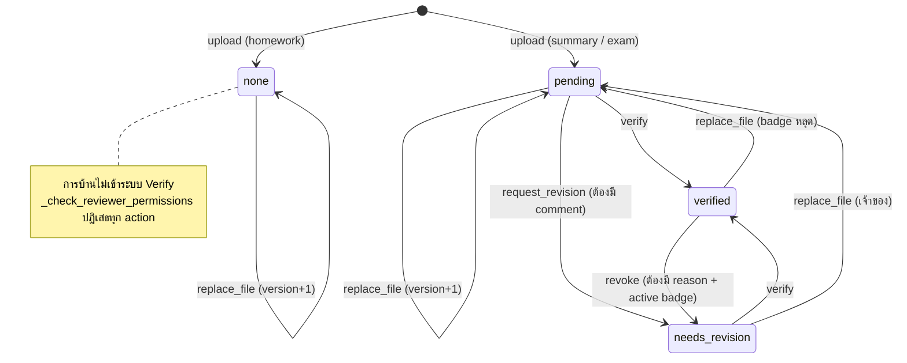
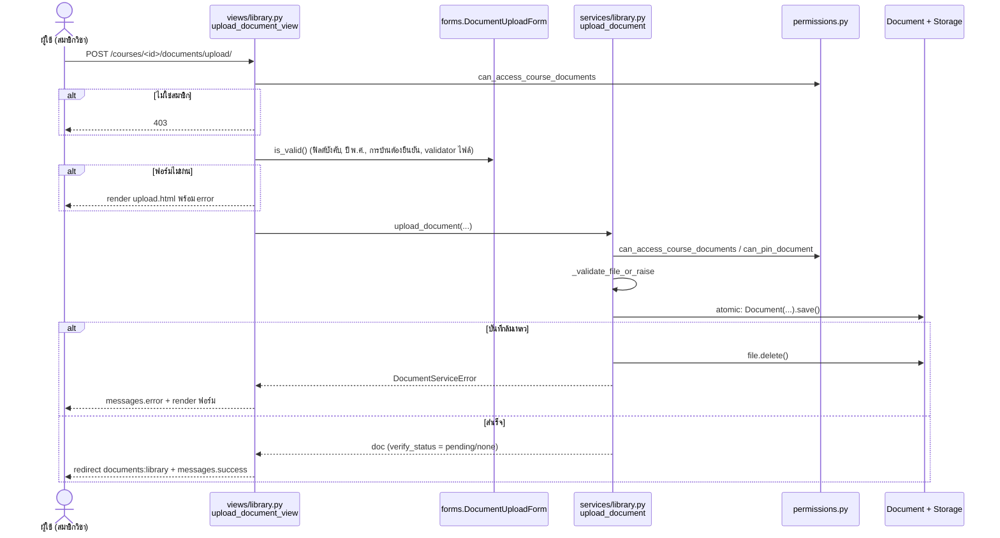
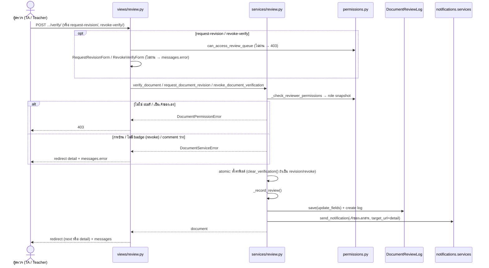
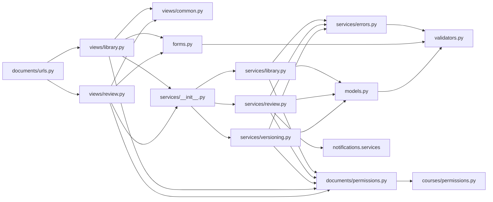

# เอกสารเทคนิค: แอป `documents` (UC3 Upload & Share, UC4 Verify)

- **ขอบเขต:** แอป `documents` และส่วนที่เกี่ยวข้อง (`courses/permissions.py`, `notifications/`, `templates/documents/`)
- **อัปเดตล่าสุด:** 2026-10-23 (branch `us03-04-pp`)
- **Stack:** Django 5, SQLite, ข้อความที่ผู้ใช้เห็นเป็นภาษาไทย

> **หมายเหตุเรื่องชื่อไฟล์:** โค้ดจริงใช้ชื่อไฟล์ตามคอลัมน์ขวา เอกสารนี้อ้างอิงชื่อจริงทั้งหมด
>
> | ชื่อที่อาจพบในโจทย์/เอกสารอื่น | ไฟล์จริง |
> |---|---|
> | `services/helpers.py` | `services/errors.py` (exception + `_validate_file_or_raise`) และ helper ภายใน `services/review.py` (`_record_review`, `_check_reviewer_permissions`) |
> | `services/uc3_library.py` | `services/library.py` |
> | `services/uc4_verify.py` | `services/review.py` + `services/versioning.py` (การแทนที่ไฟล์) |
> | `views/uc3_views.py` | `views/library.py` |
> | `views/uc4_views.py` | `views/review.py` (+ `views/common.py`) |

---

## 1. ภาพรวมและหลักการทำงาน (Overview & Core Principles)

### หลักการร่วมของทั้งสอง UC
- **Business rule และการตรวจสิทธิ์อยู่ใน service layer** view เป็นแค่ชั้นบาง ๆ ที่แปลง request ไปเป็นการเรียก service แล้วแปลงผลกลับเป็น response
- **ตรวจสิทธิ์ฝั่ง server ทุกครั้ง** ถึง template จะซ่อนปุ่มไว้แล้วก็ตาม service ก็ยังตรวจสิทธิ์ซ้ำ
- **Error สองแบบ**
  - `DocumentPermissionError` → view ตอบ `403 Forbidden`
  - `DocumentServiceError` → view แสดงข้อความผ่าน `messages.error` แล้ว redirect กลับ
- **บทบาทในรายวิชา** ใช้ `courses/permissions.py` เป็นแหล่งเดียว
  - TA ต้องมี `Enrollment.Role.TA` (สถานะ `ta_pending` ยังไม่นับเป็น TA)
  - Teacher ต้องมี `Enrollment.Role.TEACHER` และ `User.teacher_status == approved`
  - "staff" หมายถึง TA หรือ Teacher ตามเงื่อนไขข้างบน
- **Action ที่เปลี่ยนข้อมูลต้องเป็น POST + CSRF** และค่า `next` ที่ใช้ redirect จะถูกตรวจด้วย `url_has_allowed_host_and_scheme`

### UC3: Upload, Replace & Share

**1) Upload** (`upload_document`) ตรวจตามลำดับนี้
1. ผู้ใช้ต้องลงทะเบียนในวิชา (`can_access_course_documents`) ถ้าไม่ผ่าน → `DocumentPermissionError`
2. ฟิลด์บังคับครบ ได้แก่ ชื่อเอกสาร, ประเภท, ปีการศึกษา, เทอม และไฟล์
3. `doc_type` ต้องเป็นหนึ่งใน `summary` / `exam` / `homework`
4. ถ้าเป็นการบ้าน ต้องติ๊ก `confirm_past_deadline` (ยืนยันว่าเลยกำหนดส่งแล้ว)
5. ถ้าขอปักหมุดตอนอัปโหลด ผู้ใช้ต้องเป็น staff (`can_pin_document`)
6. ตรวจไฟล์ด้วย `validate_document_file`
   - นามสกุลต้องอยู่ใน `DOCUMENT_ALLOWED_EXTENSIONS` (`.pdf .docx .pptx .png .jpg`)
   - ไฟล์ต้องไม่ว่าง และขนาดไม่เกิน `DOCUMENT_MAX_FILE_SIZE_MB` (50MB)
7. บันทึกใน `transaction.atomic()`
   - ถ้าล้มเหลวกลางทาง จะลบไฟล์ที่เขียนลง storage ไปแล้ว และโยน `DocumentServiceError` จึงไม่เหลือ record ค้าง
8. ค่าเริ่มต้นที่ตั้งให้
   - `version=1`, `vote_score=0`
   - `verify_status` ตาม `Document.initial_verify_status_for_type()`: `summary`/`exam` → `pending` (เข้าคิว UC4) และ `homework` → `none` (ไม่เข้าระบบ Verify)

ไฟล์ถูกเก็บที่ `MEDIA_ROOT/documents/<course_code>/v<version>/<filename>` (ดู `document_upload_path`)

**2) Share (คลังเอกสาร + ดาวน์โหลด)**
- `list_course_documents` คืนเฉพาะเอกสารของวิชานั้น
  - กรองได้ด้วย `doc_type`, `semester`, `academic_year` และค้นหาข้อความใน title/description/related_chapter
  - `verified_only` กรองด้วย `verify_status=verified` และ `verified_version=F("version")` จึงได้เฉพาะ badge ที่ยัง active
  - เรียงลำดับด้วย `-is_pinned, -pinned_at, -created_at, -id` (เอกสารที่ปักหมุดอยู่บนสุด)
- ดาวน์โหลดผ่าน view `download_document` เท่านั้น
  - ตรวจว่าเป็นสมาชิกวิชา แล้วส่ง `FileResponse(as_attachment=True)` โดยใช้ชื่อไฟล์ต้นฉบับ
  - โปรเจกต์ไม่ได้ serve `MEDIA_URL` ตรง ๆ

**3) Pin / Unpin** (`toggle_document_pin`)
- ทำได้เฉพาะ staff ของวิชา
- ถ้าไม่ส่ง `pinned` มา จะสลับสถานะเอง
- ตอน pin จะบันทึก `pinned_by` / `pinned_at` และตอน unpin จะล้างทั้งสองค่า

**4) Replace file** (`replace_document_file`, อยู่ใน `services/versioning.py` เพราะเชื่อม UC4 กับ UC12)
- ทำได้เฉพาะเจ้าของเอกสารที่ยังเป็นสมาชิกวิชา และไฟล์ใหม่ต้องผ่าน validator ชุดเดียวกับตอนอัปโหลด
- เพิ่ม `version += 1` แล้วอัปเดตไฟล์, `original_filename` และ `file_size`
- ถ้าเป็นเอกสารที่ verify ได้ (summary/exam) **ระบบรีเซ็ตสถานะการตรวจ**
  - `verify_status = pending` (กลับเข้าคิว)
  - `Document.clear_verification()` ล้าง `verified_by`, `verified_by_name`, `verified_by_role`, `verified_at` และ `verified_version`
  - `latest_review_comment` **คงไว้** เพื่อให้เจ้าของยังเห็นความคิดเห็นเดิม
- ถ้าเป็นการบ้าน สถานะยังเป็น `none`
- การแทนที่ไฟล์ **ไม่สร้าง** `DocumentReviewLog` และ **ไม่ส่ง** notification
- ไฟล์เวอร์ชันเก่ายังอยู่ใน storage เพราะ path แยกตาม `v<version>`

### UC4: Document Verification

**คิวรอตรวจ** (`get_verification_queue`)
- เข้าได้เฉพาะ staff
- แสดงเฉพาะ `summary`/`exam` ที่มีสถานะ `pending`
- **ตัดเอกสารที่ผู้ตรวจอัปโหลดเองออก**
- เรียงแบบ FIFO (`created_at, id`)

**เงื่อนไขร่วมของทุก action** (`_check_reviewer_permissions`)
1. ผู้ตรวจต้องเป็น staff ของวิชา ถ้าไม่ใช่ → `DocumentPermissionError`
2. เอกสารต้องไม่ใช่การบ้าน ถ้าเป็น → `DocumentServiceError`
3. ผู้ตรวจต้องไม่ใช่เจ้าของเอกสาร ถ้าเป็น → `DocumentPermissionError`
4. ฟังก์ชันคืน role snapshot `"TA"` หรือ `"Teacher"` (`get_reviewer_role_snapshot`)

**สาม action ของผู้ตรวจ** ทุกตัวทำใน `transaction.atomic()` และจบด้วย `_record_review()` ซึ่งทำสามอย่าง
1. `document.save(update_fields=_REVIEW_UPDATE_FIELDS)`
2. สร้าง `DocumentReviewLog`
3. ส่ง `send_notification` ถึงเจ้าของ พร้อม `target_url` ไปหน้า detail

| Action | Service | เงื่อนไขเพิ่ม | ผลต่อฟิลด์ | Log action | Notification type |
|---|---|---|---|---|---|
| Verify (Approve) | `verify_document` | - | `verify_status=verified`, ตั้ง `verified_by`, `verified_by_name`, `verified_by_role`, `verified_at`, `verified_version=version`, ล้าง `latest_review_comment` | `verify` | `doc_verified` |
| Request Revision | `request_document_revision` | ต้องมี `comment` (หลังตัดช่องว่างแล้วไม่ว่าง) | `verify_status=needs_revision`, `clear_verification()`, `latest_review_comment=comment` | `request_revision` | `doc_revision` |
| Revoke | `revoke_document_verification` | ต้องมี active badge และต้องมี `reason` | `verify_status=needs_revision`, `clear_verification()`, `latest_review_comment=reason` | `revoke_verify` | `doc_revoked` |

**Badge ผูกกับเวอร์ชันไฟล์**
- `has_active_verified_badge` เป็นจริงเมื่อครบทุกข้อ: เอกสาร verify ได้, `verify_status == verified`, `verified_version == version` และมี `verified_by_role`
- `verified_badge_label` คืนข้อความ `"Verified by TA"` / `"Verified by Teacher"`
- ชื่อและบทบาทผู้ตรวจเก็บเป็น **snapshot** ดังนั้นถ้า TA ถูกถอนสิทธิ์ภายหลัง badge ก็ยังแสดงอยู่

**การมองเห็น** (`can_view_review_details`)
- สถานะ "รอตรวจ" / "ต้องแก้ไข", ความคิดเห็นผู้ตรวจ และประวัติ `review_logs` เห็นได้เฉพาะเจ้าของเอกสารและ staff
- สมาชิกคนอื่นเห็นแค่ badge Verified

### State Transitions (`Document.verify_status`)



> **ข้อสังเกตจากโค้ด:** service **ไม่ได้ตรวจสถานะต้นทาง** ของ `verify_document` / `request_document_revision` ส่วน UI (`templates/documents/detail.html`) ซ่อนปุ่ม Verify และส่งกลับให้แก้ไขเฉพาะตอนที่เอกสารมี active badge ดังนั้นถ้า POST ตรงเข้ามา จะ verify ซ้ำ หรือส่งเอกสารที่ verified แล้วกลับให้แก้ไขได้ ถ้าต้องการบังคับ transition ให้เข้มกว่านี้ ให้เพิ่มการตรวจใน `services/review.py`

### Shared Model Context: `Document` เชื่อมสอง UC อย่างไร

ทั้งสอง UC ใช้ `Document` ตัวเดียว เพราะ UC3 เป็นคนกำหนดสถานะเริ่มต้นของ UC4 (ตอน upload) และ UC3 ก็รีเซ็ตสถานะของ UC4 (ตอน replace) ด้วย ถ้าแยก model ออกจากกันจะต้อง sync ข้อมูลข้ามตาราง

| กลุ่มฟิลด์ | ฟิลด์ | เขียนโดย |
|---|---|---|
| ข้อมูลเอกสาร (UC3) | `course`, `uploader`, `title`, `doc_type`, `academic_year`, `semester`, `description`, `related_chapter`, `created_at`, `updated_at` | `upload_document` |
| ไฟล์และเวอร์ชัน (UC3 / UC12) | `file`, `original_filename`, `file_size`, `version` | `upload_document`, `replace_document_file` |
| ปักหมุด (UC3) | `is_pinned`, `pinned_by`, `pinned_at` | `upload_document`, `toggle_document_pin` |
| สถานะตรวจ (UC4) | `verify_status`, `latest_review_comment` | `upload_document` (ค่าเริ่มต้น), services ใน `review.py`, `replace_document_file` |
| Snapshot ผู้ตรวจ (UC4) | `verified_by`, `verified_by_name`, `verified_by_role`, `verified_at`, `verified_version` | `verify_document`, `clear_verification()` |
| อนาคต | `vote_score` (ตั้งเป็น 0 ตอนอัปโหลด) | - |

**Logic ที่อยู่บน model:**
- `VERIFIABLE_DOC_TYPES`
- `initial_verify_status_for_type()`
- `is_verifiable`, `is_homework`
- `has_active_verified_badge`, `verified_badge_label`
- `clear_verification()`

**`DocumentReviewLog`** เป็น audit log ของ UC4 แบบ append-only
- ฟิลด์: `document`, `reviewer` (`SET_NULL`), `reviewer_name_snapshot`, `reviewer_role_snapshot`, `action`, `document_version`, `comment`, `created_at`
- เรียงจากใหม่ไปเก่า

### Sequence: Upload (UC3)



### Sequence: Verify / Request Revision / Revoke (UC4)



---

## 2. โครงสร้างไฟล์และความสัมพันธ์ (File Architecture & Dependency Mapping)

### Tree

```
documents/
├── __init__.py
├── apps.py
├── admin.py                 # Document, DocumentReviewLog ใน Django admin
├── models.py                # Document, DocumentReviewLog (ใช้ร่วมกัน UC3 + UC4)
├── permissions.py           # policy ระดับเอกสาร (สร้างจาก courses/permissions.py)
├── validators.py            # ตรวจนามสกุล/ขนาดไฟล์ตาม settings
├── forms.py                 # DocumentUploadForm, RequestRevisionForm, RevokeVerifyForm, ReplaceDocumentFileForm
├── urls.py                  # app_name = "documents" (10 routes)
├── migrations/0001_initial.py
├── services/
│   ├── __init__.py          # re-export public API
│   ├── errors.py            # DocumentServiceError, DocumentPermissionError, _validate_file_or_raise
│   ├── library.py           # UC3: list_course_documents, upload_document, toggle_document_pin
│   ├── review.py            # UC4: get_verification_queue, verify / revision / revoke + _record_review
│   └── versioning.py        # replace_document_file (UC4 × UC12)
├── views/
│   ├── __init__.py          # re-export view ทั้งหมด (urls.py ใช้ views.<name>)
│   ├── common.py            # _safe_redirect
│   ├── library.py           # UC3 views
│   └── review.py            # UC4 views (+ replace_file_view)
└── tests/
    ├── __init__.py
    ├── base.py              # make_file, BaseDocumentTestCase
    ├── test_uc3_upload.py   # UC3UploadAndShareDocumentTests (5 tests)
    └── test_uc4_verify.py   # UC4VerifyDocumentTests (7 tests)

templates/documents/  library.html · upload.html · detail.html · review_queue.html
courses/permissions.py        # is_course_member / is_course_ta / is_course_teacher / is_course_staff
notifications/                # Notification model, send_notification, context processor
```

### ภาพรวม dependency



### URL → View

URL ทั้งหมดอยู่ใต้ `/courses/<course_id>/documents/` (`documents.urls` ถูก include ที่ root ใน `config/urls.py`)

| Path (ต่อจาก `/courses/<course_id>/documents/`) | Route name | View | Method | ไฟล์ |
|---|---|---|---|---|
| `` | `documents:library` | `document_library` | GET | `views/library.py` |
| `upload/` | `documents:upload` | `upload_document_view` | GET, POST | `views/library.py` |
| `<doc_id>/` | `documents:detail` | `document_detail` | GET | `views/library.py` |
| `<doc_id>/download/` | `documents:download` | `download_document` | GET | `views/library.py` |
| `<doc_id>/pin/` | `documents:toggle_pin` | `toggle_pin_view` | POST | `views/library.py` |
| `review-queue/` | `documents:review_queue` | `review_queue_view` | GET | `views/review.py` |
| `<doc_id>/verify/` | `documents:verify` | `verify_document_view` | POST | `views/review.py` |
| `<doc_id>/request-revision/` | `documents:request_revision` | `request_revision_view` | POST | `views/review.py` |
| `<doc_id>/revoke-verify/` | `documents:revoke_verify` | `revoke_verify_view` | POST | `views/review.py` |
| `<doc_id>/replace-file/` | `documents:replace_file` | `replace_file_view` | POST | `views/review.py` |

ทุก view ใช้ `@login_required` ส่วน view ที่รับ POST อย่างเดียวใช้ `@require_POST` ด้วย

### View → Service / Permission / Form / Template

| View | Service | Permission ที่ view เรียกเอง | Form | Template / Response |
|---|---|---|---|---|
| `document_library` | `list_course_documents`, `get_verification_queue` (นับคิว) | `can_view_review_details` (ทีละเอกสาร), `can_pin_document`, `can_access_review_queue` | - | `documents/library.html` |
| `upload_document_view` | `upload_document` | `can_access_course_documents`, `can_pin_document` | `DocumentUploadForm` | `documents/upload.html` → redirect `library` |
| `document_detail` | - | `can_access_course_documents`, `can_view_review_details`, `can_verify_document`, `can_revoke_verification`, `can_pin_document` | สร้าง form เปล่าของ revision / revoke / replace ไว้ให้ template | `documents/detail.html` |
| `download_document` | - | `can_access_course_documents` | - | `FileResponse` / 404 |
| `toggle_pin_view` | `toggle_document_pin` | (ตรวจใน service) | - | `_safe_redirect` → `library` |
| `review_queue_view` | `get_verification_queue` | (ตรวจใน service) | - | `documents/review_queue.html` |
| `verify_document_view` | `verify_document` | (ตรวจใน service) | - | `_safe_redirect` → `detail` |
| `request_revision_view` | `request_document_revision` | `can_access_review_queue` | `RequestRevisionForm` | `_safe_redirect` → `detail` |
| `revoke_verify_view` | `revoke_document_verification` | `can_access_review_queue` | `RevokeVerifyForm` | `_safe_redirect` → `detail` |
| `replace_file_view` | `replace_document_file` | ตรวจ `uploader_id` เอง | `ReplaceDocumentFileForm` | redirect `detail` |

### Service → Model / Permission / Helper

| Service | ไฟล์ | Model | Permission | Helper / อื่น ๆ |
|---|---|---|---|---|
| `list_course_documents` | `library.py` | `Document` | `can_access_course_documents` | `models.Q`, `models.F` |
| `upload_document` | `library.py` | `Document` | `can_access_course_documents`, `can_pin_document` | `_validate_file_or_raise`, `Document.initial_verify_status_for_type`, `transaction.atomic` |
| `toggle_document_pin` | `library.py` | `Document` | `can_pin_document` | - |
| `get_verification_queue` | `review.py` | `Document` | `can_access_review_queue` | - |
| `verify_document` | `review.py` | `Document`, `DocumentReviewLog` | `_check_reviewer_permissions` → `can_access_review_queue`, `get_reviewer_role_snapshot` | `_record_review` → `send_notification`, `_document_detail_url` |
| `request_document_revision` | `review.py` | `Document`, `DocumentReviewLog` | `_check_reviewer_permissions` | `Document.clear_verification`, `_record_review` |
| `revoke_document_verification` | `review.py` | `Document`, `DocumentReviewLog` | `_check_reviewer_permissions` | `has_active_verified_badge`, `clear_verification`, `_record_review` |
| `replace_document_file` | `versioning.py` | `Document` | `can_access_course_documents` + ตรวจเจ้าของ | `_validate_file_or_raise`, `clear_verification` |

---

## 3. หน้าที่และความรับผิดชอบของแต่ละส่วน (Component Responsibilities)

### Models & Permissions

**`models.py`**
- `document_upload_path`: สร้าง path `documents/<course_code>/v<version>/<filename>` (ใช้ `Path(...).name` กันชื่อไฟล์ที่มี path แฝงมา)
- `Document`: เก็บข้อมูลเอกสาร, choices (`DocType`, `Semester`, `VerifyStatus`, `VerifierRole`) และ business logic ที่ผูกกับข้อมูลของตัวเอง (ดูหัวข้อ Shared Model Context)
- `Meta.ordering` เรียงเอกสารที่ปักหมุดก่อน
- `DocumentReviewLog`: audit log ของ UC4

**`permissions.py`**: policy ระดับเอกสาร ทุกตัวสร้างจาก `courses/permissions.py`

| ฟังก์ชัน | ใช้ทำอะไร | เงื่อนไข |
|---|---|---|
| `can_access_course_documents(user, course)` | ดู, อัปโหลด, ดาวน์โหลด | สมาชิกวิชา (ทุกบทบาท รวม `ta_pending`) |
| `can_pin_document(user, course)` | pin / unpin, ช่อง `is_pinned` ในฟอร์ม | `is_course_staff` |
| `can_access_review_queue(user, course)` | คิวรอตรวจ, ด่านแรกของ action UC4 | `is_course_staff` |
| `get_reviewer_role_snapshot(user, course)` | ค่า `verified_by_role` / `reviewer_role_snapshot` | `"Teacher"` ถ้าเป็น teacher, `"TA"` ถ้าเป็น TA, ไม่เช่นนั้นคืน `""` |
| `can_verify_document(user, document)` | แสดงส่วนผู้ตรวจใน detail | ล็อกอินแล้ว + เอกสาร verify ได้ + ไม่ใช่เจ้าของ + staff |
| `can_revoke_verification(user, document)` | แสดงฟอร์ม revoke | `can_verify_document` + มี active badge |
| `can_view_review_details(user, document)` | เห็นสถานะรอตรวจ/ต้องแก้ไข, comment และ log | เจ้าของ หรือ staff |

**`courses/permissions.py`**
- `get_enrollment`, `is_course_member`, `is_course_ta` (เฉพาะ `Role.TA`), `is_course_teacher` (ต้องมี `teacher_status == approved` ด้วย), `is_course_staff`
- `courses/views.py: my_courses` ก็ใช้ `is_course_staff` เพื่อแสดงปุ่ม "เอกสารรอตรวจ"

**`validators.py`**
- `validate_document_file` ใช้ทั้งเป็น validator ของ `FileField` และเรียกจาก service
- helper ที่อ่านค่าจาก settings: `get_allowed_extensions*`, `get_max_file_size_*`

**`forms.py`**
- `DocumentUploadForm`
  - ตั้งค่าเริ่มต้นปีเป็น พ.ศ. ปัจจุบัน และยอมรับเฉพาะปี 2500–2700
  - การบ้านต้องติ๊กยืนยัน
  - ช่อง `is_pinned` แสดงเฉพาะ staff
- `RequestRevisionForm`, `RevokeVerifyForm`: บังคับให้มีข้อความหลังตัดช่องว่างแล้ว
- `ReplaceDocumentFileForm`: ใช้ validator ไฟล์ตัวเดียวกับตอนอัปโหลด

### Services Layer

**`services/errors.py`**: helper กลางที่ทุก service ใช้ร่วมกัน
- `DocumentServiceError`: business error ที่มีข้อความภาษาไทยสำหรับผู้ใช้
- `DocumentPermissionError(DocumentServiceError)`: สิทธิ์ไม่พอ เป็น subclass ของ `DocumentServiceError` ดังนั้นใน view ต้อง `except DocumentPermissionError` **ก่อน**
- `_validate_file_or_raise(f)`: เรียก `validate_document_file` แล้วแปลง `ValidationError` เป็น `DocumentServiceError` ด้วยข้อความแรก

**`services/library.py`** (UC3)
- `list_course_documents(*, user, course, doc_type, semester, academic_year, verified_only, query)`: queryset ที่กรองและเรียงแล้ว
- `upload_document(*, user, course, title, doc_type, academic_year, semester, uploaded_file, description, related_chapter, is_pinned, confirm_past_deadline)`: ตรวจครบทุกเงื่อนไข + บันทึกแบบ atomic + ลบไฟล์ถ้าล้มเหลว
- `toggle_document_pin(*, user, document, pinned=None)`: pin/unpin และบันทึกด้วย `update_fields`

**`services/review.py`** (UC4) รวม helper ภายในที่รวบ state transition, log และ notification ไว้ด้วยกัน
- `get_verification_queue(*, reviewer, course)`
- `verify_document(*, reviewer, document)`
- `request_document_revision(*, reviewer, document, comment)`
- `revoke_document_verification(*, reviewer, document, reason)`
- Helper ภายใน
  - `_REVIEW_UPDATE_FIELDS`: รายการฟิลด์ 8 ตัวที่ action UC4 บันทึก
  - `_check_reviewer_permissions(reviewer, document)`: ด่านตรวจสิทธิ์ร่วม คืนค่า role snapshot
  - `_document_detail_url(document)`: ลิงก์ที่ใส่ใน notification
  - `_record_review(...)`: save + สร้าง log + ส่ง notification ต้องเรียกภายใน `transaction.atomic()` เพื่อให้สามขั้นตอนนี้สำเร็จหรือ rollback ไปพร้อมกัน

**`services/versioning.py`**
- `replace_document_file(*, user, document, new_file)`: เพิ่มเวอร์ชันและรีเซ็ตสถานะการตรวจ (ดู UC3 ข้อ 4)

**`services/__init__.py`**: re-export ทุกชื่อใน `__all__`
- code เดิมและ test ยัง `from documents.services import upload_document` ได้เหมือนตอนที่ยังเป็นไฟล์เดียว (backward compatibility)
- ให้ import จาก package นี้เสมอ ไม่ต้อง import จากไฟล์ย่อยตรง ๆ

### Views Layer

**`views/common.py`**
- `_safe_redirect(request, fallback, **kwargs)`: redirect ไป `next` เฉพาะเมื่อเป็น host เดียวกัน ไม่เช่นนั้นไปที่ fallback

**`views/library.py`** (UC3)
- `document_library`
  - อ่าน filter จาก query string แล้วเรียก service (ไม่ผ่าน → 403)
  - ติด flag `doc.show_review_details` ให้แต่ละเอกสาร และนับคิวรอตรวจถ้าผู้ใช้เป็น staff
- `upload_document_view`: GET แสดงฟอร์ม ส่วน POST ตรวจฟอร์ม → เรียก service → redirect ไปคลังเอกสาร
  - `DocumentPermissionError` → 403
  - `DocumentServiceError` → แสดงข้อความในฟอร์ม
- `document_detail`: คำนวณสิทธิ์ทุกแบบส่งให้ template และแนบ `review_logs` เฉพาะผู้ที่มีสิทธิ์เห็น
- `download_document`: 403 ถ้าไม่ใช่สมาชิก และ 404 ถ้าไม่มีไฟล์
- `toggle_pin_view`: POST → service → แสดงข้อความ success/info

**`views/review.py`** (UC4)
- `review_queue_view`: แสดงคิว (ไม่ผ่าน → 403)
- `verify_document_view`: POST → `verify_document`
- `request_revision_view`, `revoke_verify_view`
  - ตรวจ `can_access_review_queue` ก่อน แล้วตรวจฟอร์ม (comment/reason)
  - จากนั้นเรียก service
- `replace_file_view`: ตรวจว่าเป็นเจ้าของ → ตรวจฟอร์มไฟล์ → `replace_document_file` → redirect detail

### Tests Layer

**`tests/base.py`**
- `make_file(filename, content, size)`: สร้าง `SimpleUploadedFile` และกำหนด `size` ปลอมได้ เพื่อทดสอบไฟล์เกินขนาด
- `BaseDocumentTestCase`
  - `setUp` override `MEDIA_ROOT` เป็นโฟลเดอร์ชั่วคราว (ลบทิ้งใน `tearDown`)
  - สร้างวิชา `CN331` และ `CN321` (`other_course`)
  - สร้างผู้ใช้: `student`, `student2`, `ta_pending`, `ta`, `ta2`, `teacher` (approved) และ `outsider`
  - ทุกคนยกเว้น `outsider` ลงทะเบียน CN331 ตามบทบาทของตัวเอง

**`tests/test_uc3_upload.py`**: `UC3UploadAndShareDocumentTests`

| Test | ตรวจอะไร |
|---|---|
| `test_only_enrolled_users_can_access_upload_and_download` | สมาชิกเท่านั้นที่อัปโหลด/ดาวน์โหลดได้ คนนอกได้ 403 |
| `test_file_type_and_size_validation` | นามสกุลที่ไม่รองรับ (`.exe`) และไฟล์เกิน 50MB (กรณีไฟล์ว่างยังไม่มี test) |
| `test_initial_statuses_and_homework_confirmation` | summary/exam ได้ `pending`, homework ได้ `none` และการบ้านต้องยืนยัน |
| `test_failed_upload_leaves_no_dangling_record` | `patch.object(Document, "save")` ให้พัง แล้วตรวจว่าจำนวน record ไม่เพิ่ม |
| `test_pin_and_unpin_by_ta_and_teacher_only_and_ordering` | สิทธิ์ pin และลำดับการแสดงผล |

**`tests/test_uc4_verify.py`**: `UC4VerifyDocumentTests`

| Test | ตรวจอะไร |
|---|---|
| `test_queue_access_and_fifo_order_and_exclusions` | สิทธิ์เข้าคิว, เรียง FIFO, ตัดเอกสารของตัวเองและการบ้านออก |
| `test_verify_by_ta_and_teacher_creates_badge_and_notification` | badge, snapshot, log และ notification |
| `test_cannot_verify_own_document_or_homework_or_without_permission` | กรณีที่ต้องถูกปฏิเสธ |
| `test_badge_persists_when_ta_role_revoked_later` | snapshot ยังอยู่หลัง TA ถูกถอนสิทธิ์ |
| `test_request_revision_and_strict_visibility_of_status_and_comments` | ต้องมี comment และใครเห็นสถานะได้บ้าง |
| `test_revoke_verification_requires_reason_and_notifies_owner` | ต้องมีเหตุผลและแจ้งเตือนเจ้าของ |
| `test_version_binding_when_owner_replaces_file` | badge หลุดเมื่อ version เปลี่ยน และกลับเข้าคิว |

---

## 4. คำสั่งสำคัญสำหรับการทดสอบและการทำงาน (Essential Commands)

ใช้ Python จาก virtualenv ของโปรเจกต์ บน Windows คือ `venv\Scripts\python` (Git Bash ใช้ `venv/Scripts/python.exe`) ตัวอย่างด้านล่างเขียนเป็น `python` ให้อ่านง่าย

### รัน Unit Tests

```bash
python manage.py test documents.tests.test_uc3_upload     # เฉพาะ UC3
python manage.py test documents.tests.test_uc4_verify     # เฉพาะ UC4
python manage.py test documents                           # ทั้งแอป documents
python manage.py test                                     # ทั้งโปรเจกต์

# test เดียว
python manage.py test documents.tests.test_uc4_verify.UC4VerifyDocumentTests.test_version_binding_when_owner_replaces_file

# ดูชื่อ test ที่รันทีละตัว
python manage.py test documents -v 2
```

ตอนรัน test, Django สลับไปใช้ locmem email backend ให้อัตโนมัติ และ `BaseDocumentTestCase` ใช้ `MEDIA_ROOT` ชั่วคราว จึงไม่มีอีเมลจริงถูกส่ง และไม่มีไฟล์ไปค้างใน `media/`

### ตรวจความปลอดภัยของ Database Schema

```bash
python manage.py makemigrations --check --dry-run   # ต้องได้ "No changes detected"
python manage.py check                              # System check ต้องไม่มี issue
python manage.py showmigrations documents notifications
```

- การ refactor ที่ไม่ได้ตั้งใจเปลี่ยน schema (เช่น ย้ายไฟล์ หรือเพิ่ม method/property ใน model) ต้องผ่าน `makemigrations --check`
- ถ้าตั้งใจเปลี่ยน model ให้รัน `makemigrations documents` แล้ว commit ไฟล์ migration ด้วย

### Debug / Verification เพิ่มเติม

**ดูสถานะเอกสารผ่าน shell**

```bash
python manage.py shell
```

```python
from documents.models import Document
from notifications.models import Notification

d = Document.objects.get(pk=1)
d.verify_status, d.version, d.verified_version, d.has_active_verified_badge
list(d.review_logs.values("action", "reviewer_name_snapshot", "document_version", "comment"))
list(Notification.objects.filter(recipient=d.uploader).values("notification_type", "title", "is_read")[:5])
```

**ทดสอบด้วยมือ (end-to-end)**
1. `python manage.py migrate && python manage.py seed_courses && python manage.py createsuperuser`
2. สมัครผู้ใช้อย่างน้อย 2 คน คือนักศึกษา 1 คน และ TA หรืออาจารย์ 1 คน
   - ถ้ายังไม่ได้ตั้งค่าอีเมล ให้ติ๊ก `email_verified` ใน `/admin/` แทน
3. ลงทะเบียนวิชาเดียวกันทั้งสองคน
   - TA จะได้สถานะ `ta_pending` ต้องเปลี่ยน `Enrollment.role` เป็น `ta` ใน `/admin/` ก่อนจึงจะตรวจเอกสารได้ (การอนุมัติ TA เป็นงานของ UC16)
   - Teacher ต้องได้รับอนุมัติผ่าน action ใน `/admin/` ก่อนลงทะเบียน
4. นักศึกษาอัปโหลดชีทสรุป → TA เปิด `/courses/<id>/documents/review-queue/` → Verify หรือส่งกลับให้แก้ไข → นักศึกษาดู `/notifications/`
5. นักศึกษาแทนที่ไฟล์ในหน้า detail → ตรวจว่า badge หายและเอกสารกลับเข้าคิว
6. ไฟล์ที่อัปโหลดจะอยู่ใน `media/documents/<course_code>/v<version>/` (`media/` ถูก gitignore ไว้แล้ว)

**จุดที่ควรรู้เวลา debug**
- **ได้ 403 ทั้งที่คิดว่ามีสิทธิ์:** ตรวจ `Enrollment.role` (ต้องเป็น `ta` ไม่ใช่ `ta_pending`) และ `User.teacher_status` (ต้องเป็น `approved`)
- **ไม่เห็นเอกสารในคิว:** คิวตัดเอกสารของผู้ตรวจเองและการบ้านออก และแสดงเฉพาะสถานะ `pending`
- **badge ไม่แสดงทั้งที่ `verify_status=verified`:** ตรวจว่า `verified_version == version` หรือไม่
- **หน้าคลังเอกสารช้าเมื่อมีเอกสารเยอะ:** `document_library` เรียก `can_view_review_details` ทีละเอกสาร ซึ่ง query `Enrollment` ใหม่ทุกครั้ง (N+1) ถ้าต้องปรับ ให้คำนวณ `is_course_staff` ครั้งเดียวต่อ request
